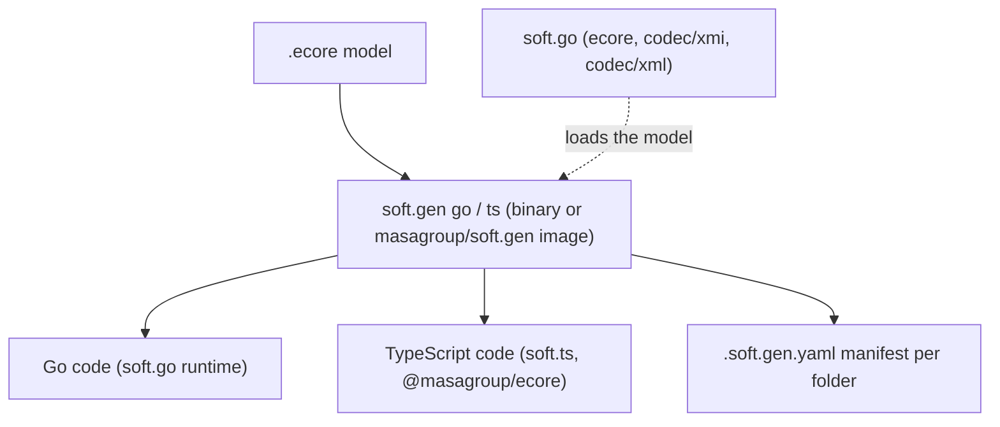
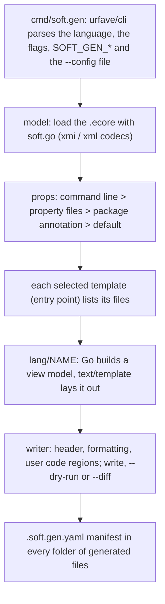
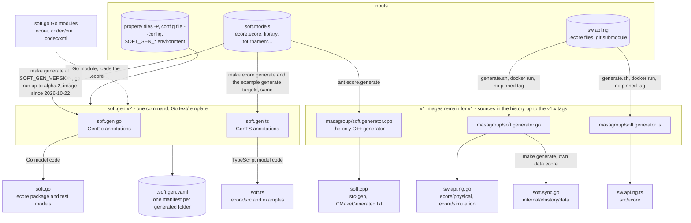
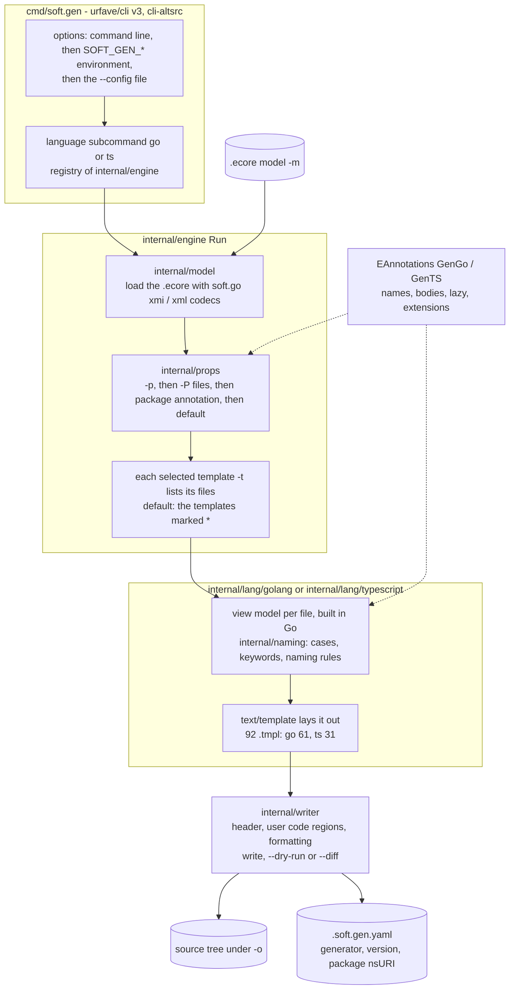
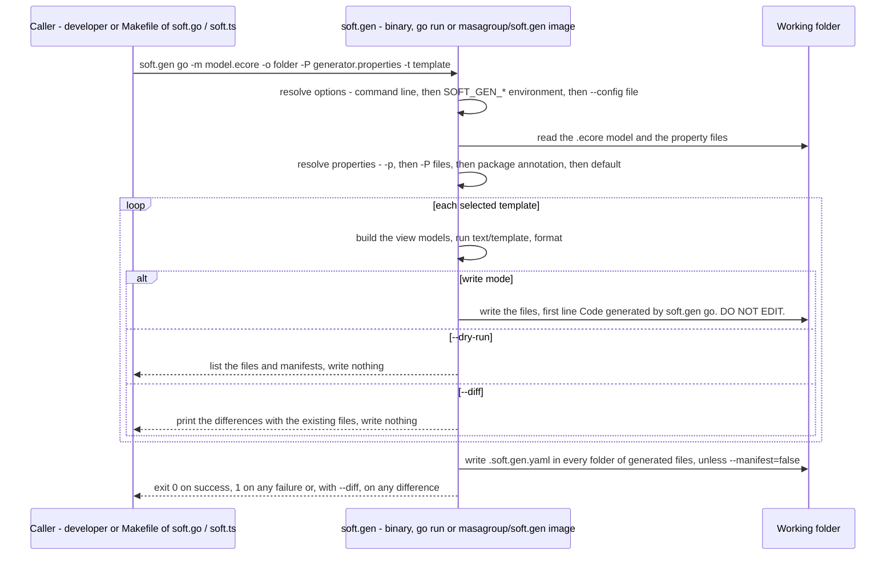
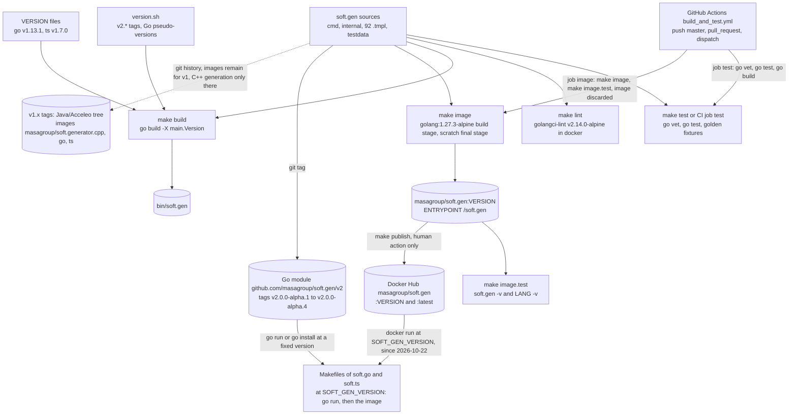

# soft.gen: architecture

> Technical choices, diagrams and internal structure of `soft.gen`. Back to the [README](README.md) · [Contributing](CONTRIBUTING.md) · [repository on GitHub](https://github.com/masagroup/soft.gen)

| | |
|---|---|
| **Family** | Ecore / esync |
| **Kind** | build tooling (code generators: one command-line tool, `soft.gen`, with one subcommand per language) |
| **Languages** | Go 1.27 (`go.mod`: `go 1.27.0`; image `golang:1.27.3-alpine`), Go `text/template` templates (92 `.tmpl`: go 61, ts 31), Makefile, Bash (`version.sh`) |
| **Remote / branch** | github.com/masagroup/soft.gen, default branch `master` |
| **Generation** | shared |
| **Build systems** | Go toolchain driven by a Makefile · Docker (one multi-stage `Dockerfile`, no compose profiles). No Ant, no Maven, no CMake build, no `package.json` |

## Overview

The repository in its ecosystem (the text is in the [README](README.md#overview)):



## Position in the ecosystem

| Concept | Relation |
|---|---|
| ecore model | Implements the code generation side: consumes `.ecore` and emits Go / TypeScript model code (`internal/model`, `internal/lang/*`); C++ being ported |
| esync | No direct relation; generated code only produces ecore objects and maps, any sync is in the runtime libraries (no `esync` hit in the repository). See the ecosystem wiki page [esync and ecore](https://github.com/masagroup/wiki/wiki/esync-ecore) |
| webclient | Indirect: the TS generator produces the model code (soft.ts, `@masagroup/ecore` runtime) a web client would use; no direct reference |
| gateway, history, dos, storage, authentication, node/pod, orchestrator, commander, hub, recorder, timeline, mapserver, datacore, dispatcher, HLA | Unrelated (no reference found) |

Known consumers of v2: the Makefiles of soft.go and soft.ts, and the `release/v2` branches of soft.sync.go and sw.api.ng.go (see Overview). The v1 `soft.generator.*` images are still run by soft.cpp, and by soft.sync.go and sw.api.ng.go on their `master`. See also the ecosystem wiki page [Next-gen ecosystem](https://github.com/masagroup/wiki/wiki/ecosystem-nextgen).

## Repository layout

```
soft.gen/
  cmd/soft.gen/                 the command (urfave/cli v3): options, language subcommands, option sources
  internal/model/               facts about an Ecore model that do not depend on the language (model loaded with soft.go)
  internal/props/               properties: declarations, resolution, .properties / .yaml / .json files
  internal/naming/              word splitting, case changes, naming rules, keyword avoidance
  internal/tmpl/                template loading, shared template functions, convention linter
  internal/writer/              file writing: header, user code regions, formatter, dry run, diff
  internal/engine/              Language contract, run loop, manifests, registry, Validate, golden tests (goldentest/)
  internal/lang/common/         what the builders of every language share
  internal/lang/golang/         Go: VERSION, view models (view_*.go), templates/
  internal/lang/typescript/     TypeScript: VERSION, view models (view_*.go), templates/
  testdata/models/              fixture models (.ecore), one topic each
  testdata/golden/{go,ts}/      expected output of the fixtures
  testdata/props/               property files of the fixtures
  .github/workflows/            build_and_test.yml (single workflow)
  Dockerfile                    image masagroup/soft.gen (golang build stage, scratch final stage)
  Makefile                      build, test, lint, image, image.test, versions, publish
  version.sh                    version of soft.gen computed from Git
  .golangci.yaml                golangci-lint configuration (the one of soft.go)
  go.mod, go.sum                module github.com/masagroup/soft.gen/v2
  README.md, TEMPLATES.md, CHANGELOG.md, LICENSE   documentation, Mozilla Public License 2.0
```

The v1 tree (Maven modules, Acceleo `.mtl` templates, `Dockerfile-<lang>`, `settings.xml`, Eclipse metadata) is removed; it remains in the history, up to the `v1.x` tags.

## Architecture

The packages are listed in Repository layout; their roles and the template conventions are detailed in [TEMPLATES.md](https://github.com/masagroup/soft.gen/blob/master/TEMPLATES.md).

Processing pipeline (`internal/engine`, `Run`):



Notable patterns:

- One rule: decisions in Go, text in templates. Go code builds a view model per file; the template only lays it out and never queries the model (`TEMPLATES.md`); conventions checked by `tmpl.Lint` through `engine.Validate`.
- Template-based generation with EMF generator semantics: an interface per `EClass`, an implementation when not abstract/interface, `EEnum`, package and factory singletons, reflective `eGet` / `eSet` / `eUnset` / `eIsSet` / `eInverseAdd` / `eInverseRemove` (`templates/reflectives/`). Go output starts with `// Code generated by soft.gen go. DO NOT EDIT.` plus optional `fileNotes`.
- Customization by `EAnnotation` on the model, using the generator namespace URI as source (custom getter/setter bodies, naming patterns, namespaces).
- Cross-model package resolution through the `packages` property/annotation (see Go and TypeScript); the default maps the Ecore nsURI to `github.com/masagroup/soft.go/ecore/ecore` (Go) or `@masagroup/ecore` (TypeScript).
- Generated code uses `NewBasicEObjectMap` / `BasicEObjectMap` for containment maps (`internal/lang/{golang,typescript}/view_feature.go`). Model synchronization lives in the runtime libraries, not here: no `esync` string appears in the repository.
- Versioning: the version of soft.gen comes from Git (`version.sh`); each language has a VERSION file (the version of its runtime), embedded in the binary and written in the manifests; `make image.test` checks the built image.
- Output parity with v1: the fixtures are cross-checked against the v1 generators (`TEMPLATES.md`, golden tests).

## How it works

soft.gen produces one command-line code generator, `soft.gen`, written in Go with `text/template` (Go module `github.com/masagroup/soft.gen/v2`, Go 1.27), with one subcommand per language: `soft.gen go` and `soft.gen ts`. A run reads one `.ecore` model (`-m`) plus properties and writes a source tree (`-o`) of model code for the Soft runtime of the language (interfaces, implementations, enums, package and factory singletons, tests, mocks, TypeScript module files), plus one `.soft.gen.yaml` manifest per generated folder. Nothing runs permanently: there is no service, no port and no network protocol. It is shared build tooling, an internal tool not shipped to customers (status inferred, UNVERIFIED), distributed as the Docker image `masagroup/soft.gen` or as a Go binary (`go install`, or `go run ...@<version>` as the Makefiles of soft.go and soft.ts do). The v1 generators (Java and Acceleo, images `masagroup/soft.generator.{cpp,go,ts}`) are in the history of the repository up to the `v1.x` tags and their images remain for v1: C++ is not ported yet, so C++ generation is v1 only, and other repositories that hold `.ecore` models may still run the v1 images (which version each pins is UNVERIFIED).

### Components and data flow



- The only data flow is `.ecore` -> `soft.gen <language>` -> source tree plus manifests. `soft.gen go` (`internal/lang/golang`) writes Go model code for soft.go (`github.com/masagroup/soft.go/ecore/ecore`, `testify` in tests and mocks); `soft.gen ts` (`internal/lang/typescript`) writes TypeScript model code, the module files `internal.ts` and `index.ts` and tests for soft.ts (`@masagroup/ecore`). C++ is not in v2 yet (being ported): C++ models still need the v1 image `masagroup/soft.generator.cpp`, whose runtime is the Ecore C++ library (CMake package `Ecore`; repository name UNVERIFIED on the soft.gen page, while the soft.cpp page describes soft.cpp as the C++ Ecore runtime generated by `soft.generator.cpp`).
- soft.gen loads the model with soft.go (Go modules `soft.go`, `codec/xmi`, `codec/xml`, pseudo-versions at commit `59e81977a22c`), which is also the runtime of the generated Go code; in turn soft.go regenerates its own `ecore` package and test models with soft.gen.
- Known v2 consumers: the Makefiles of soft.go and soft.ts pin the generator (`SOFT_GEN_VERSION`). Tags `v2.0.0-alpha.1` and `v2.0.0-alpha.2` name the command `cmd/soft-gen` and the manifest `.soft-gen.yaml`; from `v2.0.0-alpha.3` (commit `ac25c42`) they are `cmd/soft.gen` and `.soft.gen.yaml`, the names of the soft.gen page. The soft.go and soft.ts pages describe their Makefiles up to 2026-10-22: `go run .../cmd/soft-gen@v2.0.0-alpha.2`, or a `golang:1.27.3-alpine` container when Go is missing. Since 2026-10-22 their `master` runs the image `masagroup/soft.gen:<SOFT_GEN_VERSION>` instead (soft.go `v2.0.0-alpha.4`, soft.ts `v2.0.0-alpha.3`), and so do the `release/v2` branches of soft.sync.go and sw.api.ng.go (`v2.0.0-alpha.4`); the masters of soft.sync.go and sw.api.ng.go still run the v1 image.
- Repositories still on the v1 images, per their own pages (no pinned tag, so `latest`): `sw.api.ng.go/generate.sh` (`soft.generator.go -t generateModel -P generator.properties`, once per `.ecore`), `sw.api.ng.ts/generate.sh` (`soft.generator.ts -t generateModel -t generateModule -p accessors=method,property -p async=true`), `soft.sync.go` Makefile `generate` (`soft.generator.go`, the second run with `featureDelegation=Reflective`) and `soft.cpp` Ant target `ecore.generate` (`soft.generator.cpp`). Whether they move to `soft.gen` is UNVERIFIED. v2 keeps the command line, templates, properties and annotation keys of v1, and a v2 file equals the v1 file once both are formatted, but for its first line.
- soft.gen has no `esync` code: the coupling is made by the callers' properties (`packages`, `rootExtendsClass` / `rootExtendsInterface`, `featureDelegation=Reflective`), for example `rootExtendsClass = ...esync.CompactEObjectContainer` in sw.api.ng.go and `rootExtendsInterface = @masagroup/esync/EObject` in sw.api.ng.ts; esync v2 requires `featureDelegation=Reflective` and the v2 `client.ObjectImpl` / `client.Object` bases (per the ecosystem page esync-ecore.md). Downstream (per the soft.go and soft.ts pages), soft.go feeds sw.ng, sw.analysis, sw.api.ng.go, sw.datacore, io.connector, io.hla and io.nato, and `@masagroup/ecore` feeds soft.sync.ts, sw.api.ng.ts and sw.webclient.

### Inside soft.gen



- One rule: decisions in Go, text in templates. Go code builds a view model per file; the template only lays it out and never queries the model; `tmpl.Lint`, called by `engine.Validate`, checks the template conventions (`TEMPLATES.md`). Output follows EMF generator semantics: an interface per `EClass`, an implementation when not abstract or interface, `EEnum`, package and factory singletons, reflective `eGet` / `eSet` / `eUnset` / `eIsSet` / `eInverseAdd` / `eInverseRemove`.
- Templates (`-t`, default marked *): Go `generateModel` *, `generateTests` *, `generateMocks` *, `generateMocksTests` *, `generateInterfaces`, `generateImplementations`; TypeScript `generateModel` *, `generateModule` *, `generateTests` *, `generateInterfaces`, `generateImplementations`. Annotation sources: `http://net.masagroup/soft/2019/GenGo` and `http://net.masagroup/soft/2020/GenTS`.
- Properties: `fileNotes` and `debug` for every language; Go `packages`, `module`, `featureDelegation`, `packageInstance`, `checkImplementation`, `annotationContents`, `exported`, `goVersion` (default `1.19`), `rootExtendsInterface` / `Class` / `Mock`; TypeScript `packageDir`, `packages`, `paths`, `namespaces`, `moduleResolution` (`nodenext`), `allowSyntheticDefaultImports`, `testFramework` (`jest` or `vitest`), `accessors`, `async`, `featureDelegation`, `packageInstance`, `checkImplementation`, `rootExtendsInterface` / `Class`, `printWidth` (`120`). `packages` maps nsURIs to `<interface path>[#<implementation path>[#<mock path>]]`; the Ecore package maps to soft.go or `@masagroup/ecore`.
- Several implementations of one model: `generateInterfaces` once, then `generateImplementations` once per implementation with a distinct implementation path; with `packageInstance=interfaces` the package instance is generated with the interfaces and shared, and the setters check that objects share the implementation (soft.go `ecore.CheckSameImplementation` under the build tag `ecore_check`, left out with `checkImplementation=false`).
- Formatting: Go files go through `gofmt` in process; TypeScript files are written as prettier formats them with the options of soft.ts (4 spaces, no semicolons, double quotes, no trailing commas, `printWidth`), and `--format` pipes them through `prettier` when it is on the `PATH`. TypeScript files are fully overwritten (no user code regions): hand-written code goes in `<Class>Ext.ts`, `<Package>FactoryExt.ts` and body annotations.

### Startup and runtime



- Usage: `soft.gen <language> -m <model> -o <folder> [-p key=value]... [-P file]... [-t template]... [-s] [--dry-run] [--diff] [--format] [--manifest=false] [--config file]`. Every option but `-p` also comes from `SOFT_GEN_CONFIG`, `SOFT_GEN_MODEL`, `SOFT_GEN_OUTPUT`, `SOFT_GEN_PROPERTIES`, `SOFT_GEN_TEMPLATE`, `SOFT_GEN_SILENT`, `SOFT_GEN_DRY_RUN`, `SOFT_GEN_DIFF`, `SOFT_GEN_FORMAT`, `SOFT_GEN_MANIFEST`, then from the configuration file (YAML, JSON or TOML by extension, keys = long option names, lists for `template` and `properties`). `soft.gen <language> -h` prints the templates and properties of the language.
- The image runs `/soft.gen` with the language as first argument: `docker run --rm -v "$PWD":/gen -w /gen masagroup/soft.gen go -m /gen/model.ecore -o /gen`. Without Docker: `go install github.com/masagroup/soft.gen/v2/cmd/soft.gen@latest`, or `go run github.com/masagroup/soft.gen/v2/cmd/soft.gen@v2.0.0-alpha.4 go -m model.ecore -o .` (the path `cmd/soft.gen` exists from `v2.0.0-alpha.3`; no `v2.0.0` tag yet).
- Versions: `soft.gen -v` prints the version of soft.gen (Git tag, or a Go pseudo-version between tags, from `version.sh`); `soft.gen go -v` prints the version of the language, i.e. of the runtime its templates target (`VERSION` file embedded in the binary: go `v1.13.1` follows soft.go, ts `v1.7.0` follows soft.ts). The manifest records that language version and the nsURI of the package, so a new language version changes one line of each manifest and no generated file.
- `--manifest=false` leaves the manifests out but does not delete one an earlier run wrote (it stays, stale): the runs into one folder should all write the manifest, or none.
- The process is short-lived: no handshake, health check or shutdown logic. `soft.gen` exits 0 on success and 1 on any failure, so consumer pipelines can rely on the exit status; the v1 C++ and TypeScript generators exited 0 after printing an error.

### From sources to artifacts



- No Ant, no `sw.poney`, no `docker-compose.yaml`, no `prod` / `test` / `pack` profile, no `.deb` and no `packages-latest` image: the Docker-as-Artifact pattern is not used, the image is a runnable tool. On Windows, `go build ./cmd/soft.gen`, `go test ./...` and `go install` work from PowerShell; the Makefile needs a POSIX shell (`version.sh`, `grep`, `cat`), so use Git Bash (`make lint` sets `MSYS_NO_PATHCONV`).
- The `Dockerfile` builds with `golang:${GO_VERSION}-alpine` (`GO_VERSION=1.27.3`): `go mod download`, then `CGO_ENABLED=0 go build -trimpath -ldflags "-s -w -X main.Version=${VERSION}"` (`VERSION` defaults to `v2.0.0-developer-build`); the final `scratch` stage holds only `/soft.gen`. `.dockerignore` excludes `.git`, `.github`, `bin`, `dist` and `testdata`.
- `version.sh` follows the Go pseudo-version rules and counts only the `v2.*` tags, so the v1 tags do not give a v1 version to the v2 module; `make versions` prints the language versions and `make version.<lang> TO=vX.Y.Z` writes a `VERSION` file (then commit it).
- Tests: the fixtures of `testdata/models` (one topic each) render every template and are compared with `testdata/golden/{go,ts}` (`go test ./internal/lang/golang -run TestFixtures -update` rewrites them); they are cross-checked against the v1 generators (`TEMPLATES.md`). The TypeScript formatting tests (`TestPrettier`, `TestV1`) are skipped unless `SOFT_GEN_TS_TOOLS` names a directory resolving prettier and oxlint.
- CI is the single workflow `build_and_test.yml` (push on `master`, any pull request, `workflow_dispatch`): it uses no `masagroup/cicd` reusable workflow, no variable and no secret, runs neither `make lint` nor the TypeScript formatting tests, and publishes nothing. No workflow runs `make publish`: how v2 tags, GitHub releases and Docker Hub pushes are produced is UNVERIFIED (probably manual); the clone has only `v1.10.0`, `v2.0.0-alpha.1` and `v2.0.0-alpha.2`, while the examples print `v2.0.0`. CI impact: one Go build and test plus one `docker build` of a static binary, no credentials (v1 needed GitHub Packages credentials for Maven).
- v1 (Maven modules, Acceleo `.mtl` templates, `Dockerfile-<lang>`, `settings.xml`, Eclipse metadata) is removed from the tree and remains in the history up to the `v1.x` tags; the images `masagroup/soft.generator.{cpp,go,ts}` remain for v1. The v1 `settings.xml` committed a GitHub credential (`softgenbot`) that is still in the git history: treat it as compromised and rotate it (validity not tested, UNVERIFIED).

## Dependencies

### Internal (MASA repositories)

| Repository | How it is pulled | What for |
|---|---|---|
| [soft.go](https://github.com/masagroup/soft.go) | Go modules `github.com/masagroup/soft.go`, `.../codec/xmi`, `.../codec/xml` (`go.mod`, pseudo-versions of `v1.13.1` / `v1.0.1` at commit `59e81977a22c`) | loads the `.ecore` model (`internal/model/load.go`); also the runtime targeted by the generated Go code |
| soft.ts (`@masagroup/ecore`) | not a build dependency | runtime targeted by the generated TypeScript code; its prettier options shape the output |
| Ecore C++ runtime | not used by v2 | runtime of the v1 C++ generator; repository name UNVERIFIED |
| [soft](https://github.com/masagroup/soft) (`masagroup/soft`) | link in the README | documentation only |

No `.gitmodules`, no Ant `<update>` / `<update-gh>` macros, no `sw.poney`, no `FROM masagroup/*` image, no `masagroup/cicd` reusable workflow.

### External

| Component | Version (pinned) |
|---|---|
| Go | 1.27 (`go.mod`: `go 1.27.0`); build image `golang:1.27.3-alpine` (`Dockerfile`, `ARG GO_VERSION`) |
| Runtime image | `scratch` (static binary, `CGO_ENABLED=0`) |
| `github.com/urfave/cli/v3` | v3.14.0 |
| `github.com/urfave/cli-altsrc/v3` | v3.1.0 (TOML through `github.com/BurntSushi/toml` v1.5.0, indirect) |
| `go.yaml.in/yaml/v3` | v3.0.5 |
| `github.com/stretchr/testify` | v1.12.1 (tests of the generator) |
| Lint image for `make lint` | `golangci/golangci-lint:v2.14.0-alpine` |
| GitHub Actions | `actions/checkout@v4`, `actions/setup-go@v5` (Go version from `go.mod`), runner `ubuntu-latest` |
| Optional tools | `prettier` on the `PATH` for `--format` (TypeScript); `node`, prettier and oxlint for the TypeScript formatting tests (`SOFT_GEN_TS_TOOLS`). Go files are formatted with `gofmt` in process |

## Go

Annotation source: `http://net.masagroup/soft/2019/GenGo`.

Templates (`-t`), the default ones marked *:

| Template | Generates |
|---|---|
| `generateModel` * | the interfaces of the classes, the enums, the package and factory interfaces, the implementations of the classes, the package and the factory |
| `generateInterfaces` | the interfaces, enums, package and factory interfaces; with `packageInstance=interfaces`, also the shared package instance and a factory of the data types |
| `generateImplementations` | the implementations of the classes, the package (unless shared) and the factory |
| `generateTests` * | the tests of the implementations, the factory and the package |
| `generateMocks` * | the mocks of the classes |
| `generateMocksTests` * | the tests of the mocks |

Properties (all *package*: a command-line value, else the key of the GenGo
annotation of the root package):

| Property | Default | Meaning |
|---|---|---|
| `packages` | | the paths of the packages: `<nsURI>=<interface path>[#<implementation path>[#<mock path>]]`, or a path keyed by its last segment; several separated by `,`, `;` or spaces; merged with the package annotation. The ecore package is `github.com/masagroup/soft.go/ecore/ecore`; an unmapped package is `<name>/<name>` |
| `module` | | the Go module path: the output directories are the package paths minus the module |
| `featureDelegation` | | `Reflective`: the implementations delegate their features to the reflective store |
| `packageInstance` | | `interfaces`: the package instance (`GetPackage`) is generated with the interfaces and shared by the implementations |
| `checkImplementation` | `true` | `false`: the setters of a shared package do not check that the objects share the implementation |
| `annotationContents` | `false` | `true`: the objects of the contents of the annotations are created with them, by the factories of their packages (`<package>.GetFactory().Create<Class>()`, then the setters); left out by default, as in EMF. The references other than containments, the maps and the objects of the package itself are not supported: the generation fails on them |
| `exported` | `false` | `true`: the implementation names are exported |
| `goVersion` | `1.19` | the Go version of the generated code: `any` from 1.18, else `interface{}` |
| `rootExtendsInterface` | `ecore.EObject` | the interface the root interfaces embed |
| `rootExtendsClass` | `ecore.EObjectImpl` | the struct the root implementations embed |
| `rootExtendsMock` | `ecore.MockEObjectInternal` | the struct the root mocks embed |

Annotation keys of the GenGo annotation on the elements of the model:

| Element | Key | Meaning |
|---|---|---|
| package | `lazy` | `[list:\|proxy:]no\|function\|action` tokens: the lazy initialization of the features of a kind |
| package | `factory` | `extension`: the factory is the hand-written `<Package>FactoryExt` |
| package | `supressAnnotations` | annotation sources not registered by the package, separated by spaces |
| classifier | `exported`, `extension`, `instanceTypeName`, `defaultValue`, `testValue` | exported implementation names; a hand-written extension of the class; the Go type, default and test values of a data type |
| feature | `lazy`, `initializationName`, `getterBody`, `setterBody`, `unsetterBody`, `aggregation` | lazy mode; name of the init method; bodies of the accessors of a volatile feature; `shared` for a back reference |
| operation | `default` | `false`: no default implementation |
| any | `interfaceName`, `implementationName`, `extensionName`, `mockName`, `factoryName`, `packageName`, `*FileName`, `getterName`, `setterName`, `unSetterName`, `operationName` | naming rules `pattern:replacement` (or a replacement of the whole name, with `$1`), looked up on the element then its class and its package |

Generated Go code imports `github.com/masagroup/soft.go/ecore/ecore` by default, and `github.com/stretchr/testify/{assert,mock}` in the tests and mocks.

### Several implementations of a model

`generateModel` generates the interfaces of a model and one implementation of
it. The templates `generateInterfaces` and `generateImplementations` generate
them apart: with an implementation package path distinct from the interface
package path (`packages` property: `<nsURI>=<interface path>#<implementation path>`),
each implementation is a complete package, with its own package and factory
instances (`GetPackage`, `GetFactory`), and several implementations of the same
model, with different options, can be generated beside the same interfaces,
one run each:

```shell
# the interfaces, once
docker run --rm -v "$PWD":/gen -w /gen masagroup/soft.gen go -m /gen/model.ecore -o /gen -t generateInterfaces \
    -p packages=<nsURI>=example.com/m/model/model#example.com/m/model/store/store -p module=example.com/m
# an implementation with reflective feature delegation
docker run --rm -v "$PWD":/gen -w /gen masagroup/soft.gen go -m /gen/model.ecore -o /gen -t generateImplementations \
    -p packages=<nsURI>=example.com/m/model/model#example.com/m/model/store/store -p module=example.com/m \
    -p featureDelegation=Reflective
# an implementation with typed fields
docker run --rm -v "$PWD":/gen -w /gen masagroup/soft.gen go -m /gen/model.ecore -o /gen -t generateImplementations \
    -p packages=<nsURI>=example.com/m/model/model#example.com/m/model/fields/fields -p module=example.com/m
```

The implementations have the same nsURI and classifier IDs: a program chooses
one by registering its package (in the package registry of a resource set, for
example). With equal interface and implementation paths, the package and
factory instances are generated with the interfaces: use `generateModel`.

#### One package shared by the implementations

With the property `packageInstance=interfaces` (and distinct paths), the
package instance (`GetPackage`) is generated with the interfaces, by
`generateInterfaces`, with a factory of the data types of the model, and shared
by the implementations: `generateImplementations` generates the classes, whose
`EClass` is the shared one, and a factory (`GetFactory`) whose package is the
shared one, but no package. The objects of an implementation do not mix with
the objects of another: the setters of the references check it (soft.go
`ecore.CheckSameImplementation`, when the program is built with the tag
`ecore_check`; the property `checkImplementation=false` leaves these checks
out of the generated code).

```shell
docker run --rm -v "$PWD":/gen -w /gen masagroup/soft.gen go -m /gen/model.ecore -o /gen -t generateInterfaces \
    -p packageInstance=interfaces -p packages=<nsURI>=example.com/m/model/model#example.com/m/model/store/store -p module=example.com/m
docker run --rm -v "$PWD":/gen -w /gen masagroup/soft.gen go -m /gen/model.ecore -o /gen -t generateImplementations \
    -p packageInstance=interfaces -p packages=<nsURI>=example.com/m/model/model#example.com/m/model/store/store -p module=example.com/m \
    -p featureDelegation=Reflective
docker run --rm -v "$PWD":/gen -w /gen masagroup/soft.gen go -m /gen/model.ecore -o /gen -t generateImplementations \
    -p packageInstance=interfaces -p packages=<nsURI>=example.com/m/model/model#example.com/m/model/memory/memory -p module=example.com/m
```

A resource set chooses its implementation in its package registry: the
generated `Install(registry)` of an implementation registers the package and
the factory of the implementation (`memory.Install(resourceSet.GetPackageRegistry())`,
or `registry.RegisterFactory(memory.GetFactory())`). There is no global default
implementation: the factory instance of the package only converts data types,
and its `Create` panics.

## TypeScript

Annotation source: `http://net.masagroup/soft/2020/GenTS`.

Templates (`-t`), the default ones marked *:

| Template | Generates |
|---|---|
| `generateModel` * | the interfaces of the classes, the enums, the constants, the package and factory interfaces, the implementations of the classes, the package and the factory |
| `generateModule` * | the module files: `internal.ts` (every export, a class after the classes it extends) and `index.ts` (the public names) |
| `generateTests` * | the tests of the implementations and of the factory |
| `generateInterfaces` | the interfaces, enums, constants, package and factory interfaces; with `packageInstance=interfaces`, also the shared package, a factory of the data types and the module files |
| `generateImplementations` | the implementations of the classes and the factory; with `packageInstance=interfaces`, the module files of the implementation, else the package implementation |

Properties (all *package*):

| Property | Default | Meaning |
|---|---|---|
| `packageDir` | `$1` | the output directory of the package, a replacement of its name (`$1/src`) |
| `packages` | | the modules of the packages: `<nsURI>=<interface module>[#<implementation module>]`, or a module keyed by its last segment; merged with the package annotation. The ecore package is `@masagroup/ecore` |
| `paths` | | the import paths of modules, `<module>=<path>` (the module of the package is `./internal.js`) |
| `namespaces` | | the namespaces of modules, `<module>=<namespace>`, or `<module>` for named imports; by default the last segment of the module, `ecore` for `@masagroup/ecore` |
| `moduleResolution` | `nodenext` | `nodenext` or `node16`: the relative import paths end with `.js` |
| `allowSyntheticDefaultImports` | `false` | `true`: a namespace is a default import (`import ecore from`) |
| `testFramework` | `jest` | `vitest`: the tests import `describe`, `test`, `expect`... from vitest; `jest` uses its globals |
| `accessors` | `method` | `method`, `property` or `method,property`: the accessors of the features (also a feature key) |
| `async` | `false` | `true`: the proxies and operations get an `Async` variant returning a `Promise` (also an element key) |
| `featureDelegation` | | `Reflective`: the implementations delegate their features to the reflective store |
| `packageInstance` | | `interfaces`: the package instance is generated with the interfaces and shared by the implementations |
| `checkImplementation` | `true` | `false`: the setters of a shared package do not check that the objects share the implementation |
| `rootExtendsInterface` | `@masagroup/ecore/EObject` | the interface the root interfaces extend, `<module>/<name>` |
| `rootExtendsClass` | `@masagroup/ecore/EObjectImpl` | the class the root implementations extend, `<module>/<name>` |
| `printWidth` | `120` | the line width of the code, as prettier's `printWidth` (soft.ts's `ecore` uses 140) |

`packages`, `paths` and `namespaces` hold several values separated by `,`,
`;` or spaces, and concatenate the command-line and annotation values.

Annotation keys of the GenTS annotation on the elements of the model:

| Element | Key | Meaning |
|---|---|---|
| package | `lazy`, `factory`, `supressAnnotations` | as for Go; `factory=extension`: the factory is the hand-written `<Package>FactoryExt` |
| classifier | `extension`, `instanceTypeName`, `defaultValue`, `testValue` | a hand-written `<Class>Ext` extension of the implementation; the TypeScript type (`<module>/<name>` for an imported one), default and test values of a data type |
| feature | `accessors`, `async`, `lazy`, `initializationName`, `getterBody`, `setterBody`, `unsetterBody`, `aggregation` | the accessors and async variant of the feature, then as for Go |
| operation | `async`, `default` | an async variant; `false`: no default implementation |
| any | `interfaceName`, `implementationName`, `extensionName`, `factoryName`, `packageName`, `constantsName`, `*FileName`, `getterName`, `setterName`, `unSetterName`, `operationName` | naming rules, as for Go |

The generated files are fully overwritten: there are no user code regions.
Hand-written code goes in the extensions (`<Class>Ext.ts`, `<Package>FactoryExt.ts`)
and in the body annotations.

The files are written as prettier formats them with the options of soft.ts
(4 spaces, no semicolons, double quotes, no trailing commas, `printWidth`):
the lists the generator builds (imports, parameters, `extends`, exports) and
the long lines of the bodies are broken the way prettier breaks them, and a
file imports exactly the names it uses. Running prettier after a generation
changes nothing on the fixtures (`TestPrettier`); `--format` pipes
the generated files through `prettier` when it is on the `PATH`.

The shared package mode works as for Go: `generateInterfaces` with
`packageInstance=interfaces` writes the shared package with the interfaces,
and each `generateImplementations` run writes an implementation module whose
`index.ts` exports its factory, `getFactory` and `install`; the
implementation modules import the interfaces through `paths`
(`-p paths=shop=../shop/internal.js`).
