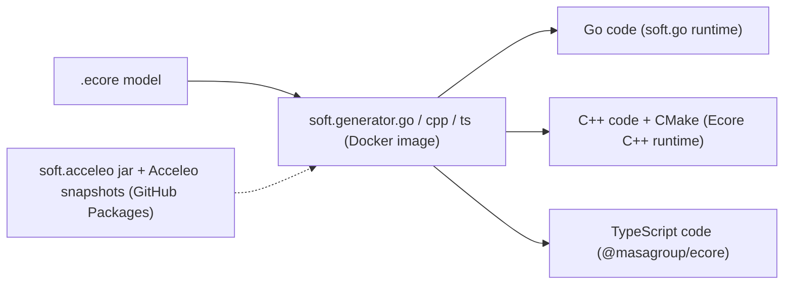
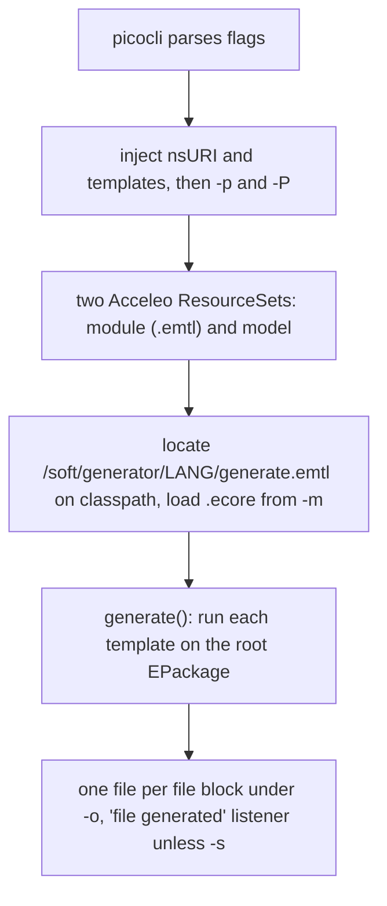

---
sword:
  schema: 1
  name: soft.gen
  family: ecore-esync
  kind: build-tooling
  generation: shared
  shipped: false  # UNVERIFIED
  languages: [Java, Acceleo, CMake, Makefile, XSLT]
  build: [maven, docker, make]
  ng: [ecore-model]
  apps:
    - name: soft.generator.cpp
      kind: build-tool
      run: "docker run --rm -v \"$PWD\":/gen -w /gen masagroup/soft.generator.cpp -s -m /gen/model.ecore -o /gen"
      ports: []
      launched_by: ["user (docker run)", "other repositories' builds (soft.cpp Ant target ecore.generate, soft.sync.go Makefile generate, sw.api.ng.go generate.sh)"]
      artifacts: "Docker image masagroup/soft.generator.cpp[:v1.2.4]; dist/soft.generator.cpp-1.2.4.tar.gz via make dist"
      status: internal-tool
      # UNVERIFIED: release process, consumer repositories and pinned tags, consequences of exit status 0 on failure, internal-tool status inferred
    - name: soft.generator.go
      kind: build-tool
      run: "docker run --rm -v \"$PWD\":/gen -w /gen masagroup/soft.generator.go -s -m /gen/model.ecore -o /gen"
      ports: []
      launched_by: ["user (docker run)", "other repositories' builds (soft.cpp Ant target ecore.generate, soft.sync.go Makefile generate, sw.api.ng.go generate.sh)"]
      artifacts: "Docker image masagroup/soft.generator.go[:v1.11.1]; dist/soft.generator.go-1.11.1.tar.gz via make dist"
      status: internal-tool
      # UNVERIFIED: release process, consumer repositories and pinned tags, consequences of exit status 0 on failure, internal-tool status inferred
    - name: soft.generator.ts
      kind: build-tool
      run: "docker run --rm -v \"$PWD\":/gen -w /gen masagroup/soft.generator.ts -s -m /gen/model.ecore -o /gen"
      ports: []
      launched_by: ["user (docker run)", "other repositories' builds (soft.cpp Ant target ecore.generate, soft.sync.go Makefile generate, sw.api.ng.go generate.sh)"]
      artifacts: "Docker image masagroup/soft.generator.ts[:v1.6.1]; dist/soft.generator.ts-1.6.1.tar.gz via make dist"
      status: internal-tool
      # UNVERIFIED: release process, consumer repositories and pinned tags, consequences of exit status 0 on failure, internal-tool status inferred
---

# soft.gen

[](https://github.com/masagroup/soft.gen/blob/master/LICENSE)


> Java/Acceleo (MTL) code generators that turn an Ecore model (`.ecore`) into Go, C++ or TypeScript model code; the "model compiler" of the Soft (EMF-like) family used by SWORD next-gen models.

| | |
|---|---|
| **Family** | Ecore / esync |
| **Kind** | build tooling (code generators, three command-line tools) |
| **Languages** | Java (source level 1.8, built with JDK 25 in Docker), Acceleo MTL templates (~85 `.mtl`: common 6, cpp 34, go 24, ts 21), CMake helper modules (4, shipped in the C++ generator), Makefile, XSLT |
| **Remote / branch** | github.com/masagroup/soft.gen, default branch `master` |
| **Generation** | shared |
| **Build systems** | Maven (inside Docker) driven by a Makefile · Docker (BuildKit, `edrevo/dockerfile-plus` frontend, no compose profiles). No Ant, no CMake build, no `go.mod`, no `package.json` |

## Overview

`soft.gen` produces three Docker images / jars, one per target language:

| Tool | Image | Generates |
|---|---|---|
| `soft.generator.go` | `masagroup/soft.generator.go` | Go model code (interfaces, implementations, enums, package/factory singletons, tests, mocks) |
| `soft.generator.cpp` | `masagroup/soft.generator.cpp` | C++ model code, library CMake project, tests CMake project (Turtle/GMock mocks) |
| `soft.generator.ts` | `masagroup/soft.generator.ts` | TypeScript model code, barrel/module files, tests |

The generators read an `.ecore` file and write a source tree. There is no service, no port and no network protocol: data flow is `.ecore` -> CLI -> source tree. The generated code is meant to compile only against the Soft runtimes: Go module `github.com/masagroup/soft.go/ecore/ecore`, the Ecore C++ library (CMake package `Ecore`, target `Ecore::ecore`) and the `@masagroup/ecore` npm package. The repository names of the C++ and TypeScript runtimes are UNVERIFIED (only package/module names appear in this repository).

Repositories that hold `.ecore` models (for example the SWORD NG models) probably run these images; which repositories do so and which tags they pin is UNVERIFIED. See the ecosystem wiki page "esync and ecore" for the whole chain.



## Repository layout

```
soft.gen/
  soft.acceleo/                 Maven jar with one class (AcceleoURIHandler) so Acceleo runs standalone in Docker/jlink
  soft.generators/              Maven multi-module parent (version 1.6.0)
    soft.generator.common/      shared launcher: Generator.java (picocli CLI), GenerateUtils.java, common .mtl templates
    soft.generator.cpp/         C++ templates (lib/, tests/, generateCMake) + bundled CMake modules (src/.../cmake/)
    soft.generator.go/          Go templates (lib/, factory, pack, tests/, mocks) + GeneratePath.java
    soft.generator.ts/          TypeScript templates (lib/, generateModule.mtl, tests/)
  .github/workflows/            build_and_test.yml (single workflow)
  Dockerfile-base               shared build stage (INCLUDE+ target)
  Dockerfile-cpp|go|ts          one image per generator
  Makefile                      generators, tests, dist, versions, publish
  pom.xslt                      XSLT used by `make versions`
  settings.xml                  Maven settings used by Docker (GitHub Packages server id `github`)
  settings.m2.xml               developer template (placeholders username / token)
  pom.xml                       root pom containing only <pom/> (purpose UNVERIFIED)
  Readme.md, LICENSE            documentation, Mozilla Public License 2.0
```

Eclipse IDE metadata (`.project`, `.classpath`, `.settings/`, `.factorypath`, `build.properties`, `META-INF/MANIFEST.MF`) is committed in each module.

## Build

### Windows (Ant)

There is no `build.xml`: Ant and `sw.poney` are not used. The build is Maven inside Docker, driven by the Makefile.

### Linux (Docker)

No `docker-compose.yaml`, no `.env`, no `prod` / `test` / `pack` profiles, no `.deb` and no `packages-latest` image: the "Docker-as-Artifact" pattern is not used. The images are runnable tools.

Prerequisites: `make`, Docker with BuildKit, access to pull the `edrevo/dockerfile-plus` syntax frontend, and a GitHub Packages credential for `masagroup/soft.acceleo` (carried by `settings.xml`, see Known issues).

Makefile targets (run from the repository root; the Makefile uses `sed`, `test`, `gzip`, so use Git Bash or Linux):

| Target | What it does |
|---|---|
| `default` | `generators tests` |
| `generators` | builds the 3 images (`generator.go`, `generator.cpp`, `generator.ts`) |
| `generator.<lang>` | `docker build --file Dockerfile-<lang> --tag masagroup/soft.generator.<lang> .` |
| `tests` | `test.go test.cpp test.ts` |
| `test.<lang>` | runs `docker run --rm -i masagroup/soft.generator.<lang> -v` and compares the printed version with the version variable of the Makefile. This is the only test: a version-consistency smoke test, no unit tests exist |
| `dist` | for each language: `docker create` + `docker cp //usr/share/soft.generator.<lang>` into `dist/soft.generator.<lang>-<version>.tar.gz` |
| `distclean` | `rm -rf dist` (`.PHONY` declares `dist.clean`, a name that does not match; harmless) |
| `versions` | rewrites versions in every `pom.xml` (via `klakegg/saxon` running `pom.xslt`), in each `META-INF/MANIFEST.MF` (`Bundle-Version`) and in the jar name inside `Dockerfile-<lang>` (via `sed`) |
| `publish` | tags and pushes `masagroup/soft.generator.<lang>:v<version>` to Docker Hub (human action only, never run by an agent) |

```
make generators          # build the 3 images
make tests               # version smoke tests
make generators dist     # images + dist/*.tar.gz (the README says "make all dist" but there is no `all` target: OUTDATED)
docker build --file Dockerfile-go --tag masagroup/soft.generator.go .   # from PowerShell, one image
```

Dockerfile structure (all start with `# syntax = edrevo/dockerfile-plus` and use `INCLUDE+ Dockerfile-base`):

| Stage | Base image | Content |
|---|---|---|
| `build` (from `Dockerfile-base`) | `maven:3.9.11-amazoncorretto-25` | `COPY . /home/soft.gen/src`; with a BuildKit cache mount on `/root/.m2` runs `mvn -f soft.acceleo/pom.xml -s settings.xml -Pdocker clean install` then `mvn -f soft.generators/pom.xml -s settings.xml -Pdocker clean verify`. Jars land in `/home/soft.gen/out/<artifactId>/` |
| `jvm` | `amazoncorretto:25-alpine3.22-jdk` | copies the generator jar(s), runs `jdeps --print-module-deps` then `jlink --strip-java-debug-attributes` to build a minimal JRE at `/java-generator` (the cpp variant adds `jdk.zipfs`) |
| final | `alpine` (unpinned) | jars in `/usr/share/soft.generator.<lang>/`, jlinked JRE in `/usr/lib/jvm/java-generator`; `ENTRYPOINT [java -jar /usr/share/soft.generator.<lang>/soft.generator.<lang>-<version>.jar]` |

The versioned jar filename is hard-coded in each `Dockerfile-<lang>` (lines 9 and 17) and updated by `make versions`. `.dockerignore` excludes dot-files/dirs (`**/.*`) and `dist`.

Version variables (single source of truth, `Makefile:3-7`):

| Variable | Value |
|---|---|
| `soft.generators.version` (parent POM) | 1.6.0 |
| `soft.generator.common.version` | 1.4.1 |
| `soft.generator.cpp.version` | 1.2.4 |
| `soft.generator.go.version` | 1.11.1 |
| `soft.generator.ts.version` | 1.6.1 |

The 12 git tags `v1.1.0` ... `v1.9.0` are repository release tags, not the per-generator versions.

### Other

#### Maven

Maven is invoked by Docker; direct local use needs the `-Pdocker` profile and a GitHub Packages token (template: `settings.m2.xml`).

- `soft.acceleo/pom.xml`: `soft.acceleo:soft.acceleo:1.0.0`, jar, source level 1.8; compiles `AcceleoURIHandler`.
- `soft.generators/pom.xml`: parent `soft.generators:soft.generators:1.6.0`, `packaging=pom`, modules `soft.generator.common`, `.cpp`, `.go`, `.ts`. Profiles: `docker` (output to `../../../out/${project.artifactId}`, `acceleo.uriHandler=soft.acceleo.AcceleoURIHandler`, adds the dependency on `soft.acceleo:soft.acceleo:1.0.0`) and `eclipse` (`activeByDefault`, output `.target`, handler `org.eclipse.acceleo.maven.AcceleoURIHandler`).
- Each generator module uses `org.eclipse.acceleo.maven:3.6.4` goal `acceleo-compile` (phase `compile`) to compile `.mtl` to `.emtl`, `maven-dependency-plugin:3.1.2 copy-dependencies` (phase `prepare-package`, so the manifest Class-Path works) and `maven-jar-plugin:3.2.0` with `mainClass=soft.generator.<lang>.Generate`.
- The cpp module also runs `maven-resources-plugin:3.1.0` (phase `validate`, filtering on) to copy `src/soft/generator/cpp/cmake/*.cmake` into the jar. The common module runs `picocli-codegen` 4.7.4 as an annotation processor.
- Dependencies are resolved from Maven Central, `repo.eclipse.org/content/repositories/acceleo` and GitHub Packages `https://maven.pkg.github.com/masagroup/soft.acceleo` (authentication required even for download).

Whether Java 1.8 source level compiles cleanly under the Maven 3.9.11 / Corretto 25 image for every module is UNVERIFIED (no build run; CI badge only).

## Run

No service, no port. Three command-line tools (one jar and one Docker image each) share a single CLI defined in `soft.generators/soft.generator.common/src/soft/generator/common/Generator.java` (picocli 4.7.4, class `Generator.Command`). There are no subcommands.

| Name | Entry point | Image | Namespace URI | Default templates |
|---|---|---|---|---|
| `soft.generator.go` | `soft.generator.go.Generate#main` | `masagroup/soft.generator.go` | `http://net.masagroup/soft/2019/GenGo` | `generateModel`, `generateTests`, `generateMocks`, `generateMocksTests` |
| `soft.generator.cpp` | `soft.generator.cpp.Generate#main` | `masagroup/soft.generator.cpp` | `http://net.masagroup/soft/2018/GenCpp` | `generateModel`, `generateLibraryCMakeSources`, `generateLibraryCMakeProject`, `generateTests`, `generateTestsCMakeDependencies`, `generateTestsCMakeSources`, `generateTestsCMakeProject` |
| `soft.generator.ts` | `soft.generator.ts.Generate#main` | `masagroup/soft.generator.ts` | `http://net.masagroup/soft/2020/GenTS` | `generateModel`, `generateModule`, `generateTests` |

Flags (identical for the three):

| Flag | Meaning |
|---|---|
| `-h, --help` | usage |
| `-v, --version` | prints `<Implementation-Title> version: <Implementation-Version>` from the jar `META-INF/MANIFEST.MF` (fallback: `<generator> version: development`) |
| `-m, --model=<model>` (required) | input `.ecore` file |
| `-o, --output=<folder>` (required) | output folder |
| `-p, --property=<k=v>` (repeatable) | sets a generator property |
| `-P, --properties=<file>` (repeatable) | loads property file(s) |
| `-s, --silent` | no `file generated: ...` output (the cpp `creating directory` / `extracting file` lines are still printed) |
| `-t, --template=<template>` (repeatable) | runs only the given templates instead of the defaults |

Typical invocation (`Readme.md:46-48`):

```
docker run --rm -v "$PWD":/gen -w /gen masagroup/soft.generator.go -s -m /gen/model.ecore -o /gen
```

Behavioral notes (code reading only, not executed):

- Exit codes: `main` catches every exception and prints only `e.getMessage()` (go, cpp) or nothing (ts, empty `catch`); no non-zero exit status is set on failure. Consumers cannot rely on the exit status. Consequences for consumer pipelines are UNVERIFIED.
- When the template `generateTestsCMakeDependencies` is selected, `soft.generator.cpp.Generate#postGenerate` copies the 4 bundled `.cmake` files out of the jar into `<output>/<pkgName>/tests/cmake/`. Only the C++ generator does this.
- Properties consumed by templates: `nsURI` and `templates` (set automatically), `packages`, `paths`, `namespaces`, `library.output.dir` and `tests.output.dir` (cpp; defaults `<pkgName>/lib` and `<pkgName>/tests`), `fileNotes` (extra header text), `debug`.
- Package-level options are read first as a `-p` / `-P` property, then as a key of the package EAnnotation:

| Generator | Package options |
|---|---|
| go | `featureDelegation` (`Reflective` selects reflective feature delegation), `exported`, `goVersion`, `module`, `rootExtendsClass`, `rootExtendsInterface`, `rootExtendsMock` |
| ts | `featureDelegation`, `accessors`, `async`, `allowSyntheticDefaultImports`, `moduleResolution`, `packageDir`, `rootExtendsClass`, `rootExtendsInterface`, `testFramework` |
| cpp | none |

- Model-level configuration is read from EAnnotations whose `source` equals the generator namespace URI (`generateCommon.mtl:30-31`). Annotation keys seen in the templates: `getterBody`, `setterBody`, `unsetterBody`, `body`, `factory`, `default`, `defaultValue`, `const`, `lazy`, `exported`, `aggregation`, `extension`, `instanceTypeName`, `async`, `accessors`, `dynamic`, `testValue`, `packages`, `paths`, `namespaces`, `include`, `mockLibrary`, `mockNamePattern`, `*Namespace` and `*NamePattern` keys, `getterName`, `setterName`, `unSetterName`, `isSetName`, `initializationName`, `supressAnnotations`.
- Generated code: Go imports `github.com/masagroup/soft.go/ecore/ecore` by default (`generatePath.mtl`) plus `github.com/stretchr/testify/{assert,mock}` in tests and mocks; TypeScript imports `@masagroup/ecore`; C++ includes `ecore/*.hpp` and its generated CMake runs `find_package(Ecore)`, `XercesC`, `Threads`, `Boost regex`, `Date`. C++ tests use `Boost 1.68.0` unit_test_framework + `Turtle 2.3.0` when the model selects Turtle mocks, otherwise `GTest` / `GMock` 1.8.1 (bundled `FindGMock.cmake`, `FindTurtle.cmake`, `BoostTest*.cmake`).

## Dependencies

### Internal (MASA repositories)

| Repository | How it is pulled | What for |
|---|---|---|
| `masagroup/soft.acceleo` ([soft.acceleo](https://github.com/masagroup/soft.acceleo)) | Maven packages from GitHub Packages `https://maven.pkg.github.com/masagroup/soft.acceleo`: `org.eclipse.acceleo.{parser,model,common,engine}:3.7.13-SNAPSHOT` plus repackaged Eclipse/OCL/OSGi jars (groupId `org.eclipse.acceleo`); declared in `soft.acceleo/pom.xml`, `soft.generators/pom.xml`, `soft.generator.common/pom.xml`. That `soft.acceleo` is the source of these packages is probable but UNVERIFIED | Patched snapshot Acceleo runtime so that Acceleo runs standalone outside Eclipse |
| `soft.acceleo:soft.acceleo:1.0.0` (built in this repository) | Maven, `docker` profile of `soft.generators/pom.xml` | `AcceleoURIHandler`: resolves `.` / `..` segments and rewrites `jar:file:...jar!/x` URIs to `classpath:/x` so `.emtl` modules resolve inside a jar / jlink image |
| [soft.go](https://github.com/masagroup/soft.go) | runtime targeted by generated Go code (`github.com/masagroup/soft.go/ecore/ecore`); not a build dependency | generated Go code compiles only against it |
| Ecore C++ runtime and `@masagroup/ecore` (TypeScript) | runtimes targeted by generated code; repository names UNVERIFIED | same, for C++ and TS |
| [soft](https://github.com/masagroup/soft) (`masagroup/soft`) | link in `Readme.md:8` | documentation only |

No `.gitmodules`, no Ant `<update>` / `<update-gh>` macros, no `sw.poney`, no `FROM masagroup/*` image, no `masagroup/cicd` reusable workflow.

### External

| Component | Version (pinned) |
|---|---|
| Build image | `maven:3.9.11-amazoncorretto-25` (`Dockerfile-base:2`) |
| JRE / jlink image | `amazoncorretto:25-alpine3.22-jdk` (`Dockerfile-{go,cpp,ts}:6`) |
| Runtime image | `alpine` (unpinned) |
| Dockerfile frontend | `edrevo/dockerfile-plus` (unpinned) |
| XSLT tool for `make versions` | `klakegg/saxon` (unpinned) |
| Java source/target | 1.8 (`maven-compiler-plugin:3.8.1`), built by JDK 25, `jdeps --multi-release 25` |
| picocli / picocli-codegen | 4.7.4 |
| Guava | 32.1.1-jre |
| Eclipse EMF common / ecore / xmi | 2.18.0 / 2.21.0 / 2.16.0 |
| Acceleo (engine / common / model / parser) | 3.7.13-SNAPSHOT (GitHub Packages); Acceleo Maven plugin `org.eclipse.acceleo.maven:3.6.4` |
| Eclipse OCL | `org.eclipse.ocl` 3.4.2.v20140725-2242, `ocl.ecore` 3.3.100.v20140610-0641, `ocl.common` 1.2.0.v20140610-0641 |
| Other Eclipse/OSGi jars (2013-2014) | `lpg.runtime.java` 2.0.17.v201004271640, `core.runtime` 3.10.0.v20140318-2214, `core.resources` 3.9.1.v20140825-1431, `equinox.common` 3.6.200.v20130402-1505, `equinox.registry` 3.5.400.v20140428-1507, `core.contenttype` 3.4.200.v20140207-1251, `equinox.preferences` 3.4.1, `osgi.framework` 1.9.0 |
| Maven plugins | compiler 3.8.1, dependency 3.1.2, jar 3.2.0, resources 3.1.0 |
| GitHub Actions | `actions/checkout@v4`, runner `ubuntu-latest` |
| IDE (docs only) | Eclipse Modeling Tools, m2e, Immutables APT, Acceleo (`Readme.md:73-79`) |

The Eclipse stack is old (2013-2014 OCL/Equinox) and Acceleo is a SNAPSHOT: builds are not strictly reproducible and a change in the snapshot silently changes generated output.

## Architecture

| Component | Role |
|---|---|
| `soft.acceleo/` | Tiny jar enabling standalone Acceleo execution inside Docker/jlink |
| `soft.generator.common` | `Generator.java` (picocli CLI, Acceleo `AbstractAcceleoGenerator` subclass, model/module loading), `GenerateUtils.java` (helpers callable from MTL, static `currentPackage`), common `.mtl`: `generateCommon`, `generateElement`, `generatePackage`, `generateReflectives`, `generateStructuralFeature`, `generateUtils` |
| `soft.generator.cpp` | `lib/{cls,factory,pack}` (interface, base header/source, internal, implementation, factory, package, exports, enum, datatype), `tests/` (Turtle/GMock mocks, tests CMake), `generateCMake` (library CMake), bundled CMake modules |
| `soft.generator.go` | `lib/` (interface, implementation, enum, operations, structural features, reflectives), `lib/factory`, `lib/pack`, `tests/` (implementation, factory, package tests, mocks, mock tests), `GeneratePath.java` (unique Go import aliases from package paths) |
| `soft.generator.ts` | `lib/` (same structure as Go), `generateModule.mtl` (index/internal barrel files, `paths` / `namespaces` / `packages`), `tests/` |

Processing pipeline (`Generator.initialize()`, `Generator.java:215-289`):



Notable patterns:

- Template-based generation with EMF generator semantics: an interface per `EClass`, an implementation when not abstract/interface, `EEnum`, package and factory singletons, reflective `eGet` / `eSet` / `eUnset` / `eIsSet` / `eInverseAdd` / `eInverseRemove` (`generateReflectives.mtl`). Go output starts with `Code generated by soft.generator.go. DO NOT EDIT.` plus optional `fileNotes`.
- Customization by `EAnnotation` on the model, using the generator namespace URI as source (custom getter/setter bodies, naming patterns, namespaces).
- Cross-model package resolution through the `packages` property/annotation: entries `name=path`, `uri=path` or `path#alias`, separated by `,;` or whitespace; the default maps the Ecore nsURI to `github.com/masagroup/soft.go/ecore/ecore` (Go).
- Generated code uses `NewBasicEObjectMap` / `BasicEObjectMap` for containment maps (go `generateStructuralFeature.mtl:67,71`; ts `generateImplementation.mtl:45`). Model synchronization lives in the runtime libraries, not here: no `esync` string appears in the repository.
- Versioning is per generator and recorded in four places (Makefile, `pom.xml`, `MANIFEST.MF`, Dockerfile jar name); `make versions` aligns them and `make tests` checks the built image.

## CI/CD

| Workflow | Triggers | What it does |
|---|---|---|
| `.github/workflows/build_and_test.yml` ("Build And Test") | `pull_request` (opened, synchronize, reopened, ready_for_review) on `master`; `push` on `master`; `workflow_dispatch` | one job on `ubuntu-latest`: `actions/checkout@v4`, `make generators`, `make tests` |

- It does not use any `masagroup/cicd` reusable workflow (no shared `uses:`, no repository/organization variable override, no secrets). This deviates from the ecosystem convention; see [cicd](https://github.com/masagroup/cicd) and the ecosystem wiki page "CI/CD pipelines".
- No release job. The README mentions GitHub releases and Docker Hub, and `make dist` / `make publish` exist, but no workflow runs them. How the `v1.x.y` tags, release assets and Docker Hub pushes are produced is UNVERIFIED (probably manual via `make publish`).
- Artifacts: none produced by CI (images are built then discarded). Locally: `dist/soft.generator.<lang>-<version>.tar.gz` and images `masagroup/soft.generator.<lang>[:v<version>]`. Docker Hub tag convention beyond `latest` and `v<version>` (`Makefile:72-73`) is UNVERIFIED; the `org/repo:component-version` convention is not used.
- CI impact: each `docker build` re-runs the full Maven build (acceleo plus 4 modules, 3 times; BuildKit cache mount only on `/root/.m2`), and the Maven build needs GitHub Packages credentials, currently committed in `settings.xml`.

## Next-gen relevance

| Concept | Relation |
|---|---|
| ecore model | Implements the code generation side: consumes `.ecore` and emits Go / C++ / TypeScript model code (`Generator.java`, per-language `generate.mtl`) |
| esync | No direct relation; generated code only produces ecore objects and maps, any sync is in the runtime libraries (no `esync` hit in the repository). See the ecosystem wiki page "esync and ecore" |
| webclient | Indirect: the TS generator produces the model code (`@masagroup/ecore` runtime) a web client would use; no direct reference |
| gateway, history, dos, storage, authentication, node/pod, orchestrator, commander, hub, recorder, timeline, mapserver, datacore, dispatcher, HLA | Unrelated (no reference found) |

Which repositories consume these images is UNVERIFIED; grep the other repositories for `soft.generator`. See also the ecosystem wiki page "Next-gen ecosystem".

## Known issues

No audit document exists in the repository. Defects and outdated documentation found by the scan:

- `Readme.md` OUTDATED: `make all dist` (no `all` target; use `make generators dist`); example go version `1.5.0` (`Readme.md:30,44`) while the current go version is `1.11.1`; typo `sof.generator.<lang>-<version>.jar` (real name `soft.generator.<lang>-<version>.jar`).
- `Readme.md` claims "Java JRE 8+" for release archives: UNVERIFIED (jars are built for source/target 1.8 but the build uses JDK 25; the `make dist` archive contains the jars only, the jlinked JRE is under `/usr/lib/jvm/java-generator`, so a JRE must be installed separately).
- The README does not mention `featureDelegation=Reflective`, `fileNotes`, the `packages` / `paths` / `namespaces` properties, the annotation keys, or the unreliable exit codes.
- Security: `settings.xml` is committed, used by the Docker build and copied into the `build` stage (`COPY . /home/soft.gen/src`). It contains a GitHub credential for user `softgenbot` (password obfuscated only with numeric XML character references; it is in git history). Treat it as compromised: revoke/rotate and use a BuildKit secret mount (`RUN --mount=type=secret`) or a CI secret. The value is deliberately not reproduced here. Final images are `alpine` + jars so the file is probably absent from final layers (inferred, image content not inspected).
- The runtime image uses unpinned `alpine`, and helper images `edrevo/dockerfile-plus` and `klakegg/saxon` are unpinned; no digest pinning, SBOM or image scan in CI. Snapshot Acceleo dependency and 2013-2014 Eclipse jars, no vulnerability scanning visible.
- `main` swallows exceptions and exits 0 (see Run).

## Open questions

- UNVERIFIED: release process. No workflow performs releases or Docker Hub pushes. Who runs `make publish` and where are release archives uploaded?
- UNVERIFIED: which repositories consume these generators and which image tags they pin.
- UNVERIFIED: whether the `soft.acceleo` GitHub Packages snapshots (3.7.13-SNAPSHOT) are still needed or replaceable by released Acceleo artifacts.
- UNVERIFIED: purpose of the root `pom.xml` (`<pom/>`; inference: input for the `make versions` XSLT).
- UNVERIFIED: whether the committed `softgenbot` credential is still valid (not tested); rotate regardless.
- UNVERIFIED: consequences of the "swallow exceptions, exit 0" behavior for consumer pipelines.
- UNVERIFIED: whether Java 1.8 source level compiles cleanly under the Maven 3.9.11 / Corretto 25 image for every module.
- UNVERIFIED: Docker Hub tag convention beyond `latest` and `v<version>`.
- UNVERIFIED: repository names of the C++ and TypeScript Ecore runtimes.
- UNVERIFIED: whether "Java JRE 8+" in the README still holds for the release archives.

## Legacy notes

*Content kept from the previous README, not re-verified against the code.*

### Soft Generators

Soft Generators is an implementation of EMF generators for C++, Go and TypeScript languages

### Installation

#### Github Release

- Install a Java JRE 8+
- Download archive of a generator from the [project releases page](https://github.com/masagroup/soft.gen/releases)
- Unzip archive

Generator can now be run with the following command:

```shell
$ java -jar sof.generator.<lang>-<version>.jar --version

<lang>    = the generator language : go, ts, cpp
<version> = the generator version
```

Example:
```shell
$ java -jar soft.generator.go-1.5.0.jar --version
soft.generator.go version: 1.5.0
```

#### Docker Hub

Use the Docker images available from Docker Hub:
- [Cpp generator image](https://hub.docker.com/r/masagroup/soft.generator.cpp)
- [Go generator image](https://hub.docker.com/r/masagroup/soft.generator.go)
- [TypeScript generator image](https://hub.docker.com/r/masagroup/soft.generator.ts)

Example:
```shell
$ docker run --rm masagroup/soft.generator.go  --version
soft.generator.go version: 1.5.0
```

### Usage

```
Usage: [-hsv] -m=<model> -o=<folder> [-p=<property=value>]... [-P=<propertyfile>]... [-t=<template>]...
  -h, --help                        print this help and exit
  -m, --model=<model>               the input model
  -o, --output=<folder>             the output folder
  -p, --property=<property=value>   set value for given property
  -P, --properties=<propertyfile>   load properties from a property file
  -s, --silent                      print nothing but failures
  -t, --template=<template>         the template to be executed: <templates list>
  -v, --version                     print version information and exit
```

### IDE

If you want to debug generators with an Eclipse IDE, you'll need:
- [Eclipse IDE Modeling Tools](https://www.eclipse.org/downloads/)
- [Eclipse IDE integration for Maven](https://download.eclipse.org/technology/m2e/releases/latest/)
  - maven should be configured with github as available maven repository by adding [settings.xml](settings.m2.xml) in ${user}/.m2 directory
- [Annotation Processor in IDE](https://immutables.github.io/apt.html)
- [Acceleo](https://download.eclipse.org/acceleo/updates/releases)
