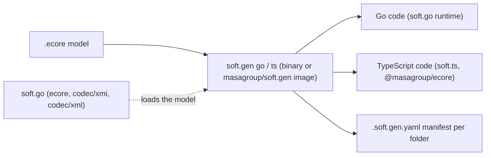
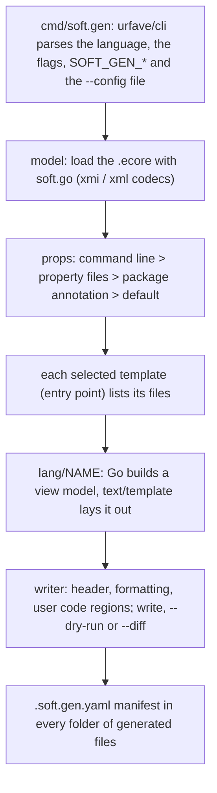

<!--
sword:
  schema: 1
  name: soft.gen
  family: ecore-esync
  kind: build-tooling
  generation: shared
  shipped: false  # UNVERIFIED
  languages: [Go, Go text/template, Makefile, Bash]
  build: [go, make, docker]
  ng: [ecore-model]
  apps:
    - name: soft.gen
      kind: build-tool
      run: "docker run --rm -v \"$PWD\":/gen -w /gen masagroup/soft.gen go -m /gen/model.ecore -o /gen"
      ports: []
      launched_by: ["user (docker run, go install, go run)", "the Makefiles of soft.go and soft.ts (image masagroup/soft.gen:<SOFT_GEN_VERSION> since 2026-10-22; go run github.com/masagroup/soft.gen/v2/cmd/soft-gen@v2.0.0-alpha.2 before)", "the release/v2 branches of soft.sync.go (Makefile) and sw.api.ng.go (generate.sh)"]
      artifacts: "Docker image masagroup/soft.gen[:<version>] via make image / make publish; binary bin/soft.gen via make build; go install github.com/masagroup/soft.gen/v2/cmd/soft.gen@<version>"
      status: internal-tool
      # UNVERIFIED: release process (no CI publish job), internal-tool status inferred
-->

# soft.gen

[](https://github.com/masagroup/soft.gen/blob/master/LICENSE)


> Go (`text/template`) code generators, one command `soft.gen`, that turn an Ecore model (`.ecore`) into Go or TypeScript model code (C++ is being ported); the "model compiler" of the Soft (EMF-like) family used by SWORD next-gen models.

| | |
|---|---|
| **Family** | Ecore / esync |
| **Kind** | build tooling (code generators: one command-line tool, `soft.gen`, with one subcommand per language) |
| **Languages** | Go 1.27 (`go.mod`: `go 1.27.0`; image `golang:1.27.3-alpine`), Go `text/template` templates (92 `.tmpl`: go 61, ts 31), Makefile, Bash (`version.sh`) |
| **Remote / branch** | github.com/masagroup/soft.gen, default branch `master` |
| **Generation** | shared |
| **Build systems** | Go toolchain driven by a Makefile · Docker (one multi-stage `Dockerfile`, no compose profiles). No Ant, no Maven, no CMake build, no `package.json` |

## Overview

The EMF code generators of [Soft](https://github.com/masagroup/soft), written
in Go with `text/template` (Go module `github.com/masagroup/soft.gen/v2`).
They generate, from an Ecore model, the code of a model for the Soft runtime
of a language: Go (`soft.go`) and TypeScript (`soft.ts`); C++ is being ported.

The v1 generators (Acceleo templates driven by Java) are in the history of this
repository, up to the `v1.x` tags. A file generated by v2 is identical to the
file generated by v1 once both are formatted (`gofmt`, or prettier after
removing the unused imports), but for its first line, which names the
generator. The command line, the templates, the properties and the annotation
keys are the ones of v1. The v1 per-language images (`masagroup/soft.generator.{cpp,go,ts}`) remain for v1.

| Language (`soft.gen <language>`) | Package | Generates | Runtime of the generated code |
|---|---|---|---|
| `go` | `internal/lang/golang` | Go model code (interfaces, implementations, enums, package/factory singletons, tests, mocks) | soft.go (`github.com/masagroup/soft.go/ecore/ecore`) |
| `ts` | `internal/lang/typescript` | TypeScript model code, module files (`internal.ts`, `index.ts`), tests | soft.ts (`@masagroup/ecore`) |
| C++ | not in v2 yet (being ported) | v1 only (`masagroup/soft.generator.cpp`) | Ecore C++ library (CMake package `Ecore`); repository name UNVERIFIED |

There is no service, no port and no network protocol: data flow is `.ecore` -> `soft.gen <language>` -> source tree (plus one `.soft.gen.yaml` manifest per generated folder). The generated code is meant to compile only against the Soft runtime of its language.

The Makefiles of soft.go and soft.ts run the generator at a fixed version, `SOFT_GEN_VERSION`. The command was `cmd/soft-gen` up to `v2.0.0-alpha.2` and is `cmd/soft.gen` from `v2.0.0-alpha.3` (commit `ac25c42`, "Rename soft-gen into soft.gen"): a `go run` must use the path of the tag it names, such as `go run .../cmd/soft-gen@v2.0.0-alpha.2` (what soft.go and soft.ts ran until 2026-10-22) or `go run .../cmd/soft.gen@v2.0.0-alpha.4`. Since 2026-10-22 their `master` runs the image `masagroup/soft.gen:$(SOFT_GEN_VERSION)` instead (soft.go `v2.0.0-alpha.4`, soft.ts `v2.0.0-alpha.3`), as do the `release/v2` branches of soft.sync.go (`Makefile`) and sw.api.ng.go (`generate.sh`), both at `v2.0.0-alpha.4`. On their `master`, `soft.cpp` (Ant target `ecore.generate`, `masagroup/soft.generator.cpp`), `soft.sync.go` (Makefile `generate`) and `sw.api.ng.go` (`generate.sh`, both `masagroup/soft.generator.go`) still run the v1 images, without a tag. See the ecosystem wiki page "esync and ecore" for the whole chain.



## Repository layout

```
soft.gen/
  cmd/soft.gen/                 the command (urfave/cli v3): options, language subcommands, option sources
  internal/model/               facts about an Ecore model that do not depend on the language (model loaded with soft.go)
  internal/props/               properties: declarations, resolution, .properties / .yaml / .json files
  internal/naming/              word splitting, case changes, naming rules, keyword avoidance
  internal/tmpl/                template loading, shared template functions, convention linter
  internal/writer/              file writing: header, user code regions, formatter, dry run, diff
  internal/engine/              Language contract, run loop, manifests, registry, Validate, golden tests (goldentest/)
  internal/lang/common/         what the builders of every language share
  internal/lang/golang/         Go: VERSION, view models (view_*.go), templates/
  internal/lang/typescript/     TypeScript: VERSION, view models (view_*.go), templates/
  testdata/models/              fixture models (.ecore), one topic each
  testdata/golden/{go,ts}/      expected output of the fixtures
  testdata/props/               property files of the fixtures
  .github/workflows/            build_and_test.yml (single workflow)
  Dockerfile                    image masagroup/soft.gen (golang build stage, scratch final stage)
  Makefile                      build, test, lint, image, image.test, versions, publish
  version.sh                    version of soft.gen computed from Git
  .golangci.yaml                golangci-lint configuration (the one of soft.go)
  go.mod, go.sum                module github.com/masagroup/soft.gen/v2
  README.md, TEMPLATES.md, CHANGELOG.md, LICENSE   documentation, Mozilla Public License 2.0
```

The v1 tree (Maven modules, Acceleo `.mtl` templates, `Dockerfile-<lang>`, `settings.xml`, Eclipse metadata) is removed; it remains in the history, up to the `v1.x` tags.

## Build

### Windows (Ant)

There is no `build.xml`: Ant and `sw.poney` are not used. The build is the Go toolchain (Go 1.27), driven by the Makefile. `go build ./cmd/soft.gen`, `go test ./...` and `go install` work from PowerShell; the Makefile needs a POSIX shell (`version.sh`, `grep`, `cat`), so use Git Bash on Windows (`make lint` sets `MSYS_NO_PATHCONV` for it).

### Linux (Docker)

No `docker-compose.yaml`, no `.env`, no `prod` / `test` / `pack` profiles, no `.deb` and no `packages-latest` image: the "Docker-as-Artifact" pattern is not used. The image is a runnable tool.

| Stage | Base image | Content |
|---|---|---|
| `build` | `golang:${GO_VERSION}-alpine` (`GO_VERSION=1.27.3`) | `go mod download`, then `CGO_ENABLED=0 go build -trimpath -ldflags "-s -w -X main.Version=${VERSION}"` (build argument `VERSION`, default `v2.0.0-developer-build`) |
| final | `scratch` | the static binary `/soft.gen`; `ENTRYPOINT ["/soft.gen"]` |

`.dockerignore` excludes `.git`, `.github`, `bin`, `dist` and `testdata`.

```
make image image.test                              # the image, with VERSION from version.sh, and the check of its versions
docker build --tag masagroup/soft.gen .            # from PowerShell, VERSION left to its default
```

### Go and Make

Makefile targets (`make` alone runs `build`):

| Target | What it does |
|---|---|
| `build` | `go build -ldflags "-X main.Version=$(VERSION)" -o bin/soft.gen ./cmd/soft.gen` |
| `test` | `go vet ./...` then `go test ./...` |
| `lint` | golangci-lint (`.golangci.yaml`) in the image `golangci/golangci-lint:v2.14.0-alpine`; sources mounted read-only, Go modules and lint cache in the docker volumes `soft.gen-gomod` and `soft.gen-golangci` |
| `image` | `docker build --build-arg VERSION=$(VERSION) --tag masagroup/soft.gen .` (`IMAGE` overridable) |
| `image.test` | checks that `soft.gen -v` in the image prints `soft.gen version: $(VERSION)` and that each language reports the version of the sources (`go run ./cmd/soft.gen <lang> -v`) |
| `versions` | prints the version of each language |
| `version.<lang>` | prints the version of a language; with `TO=vX.Y.Z`, writes it in its VERSION file (then commit the file) |
| `publish` | tags `masagroup/soft.gen:$(VERSION)` and pushes it and `:latest` to Docker Hub (human action only, never run by an agent) |

`VERSION` (the version of soft.gen) comes from `version.sh`, with the rules of the Go pseudo-versions; only the `v2.*` tags count, so the v1 tags do not give a v1 version to the v2 module. The version of each language is its VERSION file:

| Language | VERSION file | Value | Follows |
|---|---|---|---|
| go | `internal/lang/golang/VERSION` | v1.13.1 | soft.go |
| ts | `internal/lang/typescript/VERSION` | v1.7.0 | soft.ts |

Tags: `v1.10.0` (last v1 tag), then `v2.0.0-alpha.1` (2026-10-21) to `v2.0.0-alpha.4` (2026-10-23). The command is `cmd/soft-gen` in `v2.0.0-alpha.1` and `v2.0.0-alpha.2`, and `cmd/soft.gen` from `v2.0.0-alpha.3`.

### Development

```shell
go test ./...          # unit tests, and the fixtures compared with their expected files
make lint              # golangci-lint with .golangci.yaml, in docker
make image image.test  # the docker image, and the check of its versions
make versions          # the version of each language (make version.<lang> TO=vX.Y.Z sets one)
```

The fixtures are small models in `testdata/models`, each about one topic,
whose expected output is committed in `testdata/golden`; together they render
every template of the generator. After an intended change of the output:

```shell
go test ./internal/lang/golang -run TestFixtures -update   # write the new expected files, then review them with git
```

See [TEMPLATES.md](TEMPLATES.md#golden-tests) for the v1 cross-check. The TypeScript formatting tests (`TestPrettier`, `TestV1`) are skipped unless `SOFT_GEN_TS_TOOLS` names a directory resolving prettier and oxlint (with `node` on the `PATH`).

How the generators are organized, the template conventions and how to add a
language: [TEMPLATES.md](TEMPLATES.md). Changes from v1: [CHANGELOG.md](CHANGELOG.md).

## Run

No service, no port. One command-line tool, `soft.gen` (binary or Docker image), with one subcommand per language (`go`, `ts`); the CLI is in `cmd/soft.gen` (urfave/cli v3, cli-altsrc).

### Installation

One docker image holds every language:

```shell
docker run --rm masagroup/soft.gen -v
soft.gen version: v2.0.0
docker run --rm masagroup/soft.gen go -v
soft.gen go version: v1.13.1
```

The version of soft.gen is the Git tag of the build (`v2.0.0`), or between two
tags a Go pseudo-version such as `v2.0.1-0.20261021125246-3166c30bb912`,
computed by `version.sh`. The version of a language is the version of the
runtime its templates target: the Go generator `v1.13.1` generates code for
soft.go `v1.13`. It is the `VERSION` file of the language
(`internal/lang/golang/VERSION`), embedded in the binary, so every build
reports it; `make versions` prints them, `make version.go TO=v1.14.0` sets one.

Or install the binary (Go 1.27), or run it without installing, at a fixed
version (the Makefiles of soft.go and soft.ts did so up to `v2.0.0-alpha.2`):

```shell
go install github.com/masagroup/soft.gen/v2/cmd/soft.gen@latest
go run github.com/masagroup/soft.gen/v2/cmd/soft.gen@v2.0.0-alpha.4 go -m model.ecore -o .
```

The path `cmd/soft.gen` exists from `v2.0.0-alpha.3`; `v2.0.0-alpha.1` and `v2.0.0-alpha.2` name it `cmd/soft-gen`.

### Usage

```
soft.gen <language> -m <model> -o <folder> [-p key=value]... [-P file]... [-t template]... [-s] [--dry-run] [--diff] [--format] [--manifest=false] [--config file]
  --config, -c file       read the options from a configuration file (.yaml, .yml, .json, .toml)   $SOFT_GEN_CONFIG
  --model, -m string      the input model                                                          $SOFT_GEN_MODEL
  --output, -o string     the output folder                                                        $SOFT_GEN_OUTPUT
  --property, -p k=v      set value for given property, repeatable
  --properties, -P file   load properties from a property file (.json, .properties, .yaml, .yml)  $SOFT_GEN_PROPERTIES
  --template, -t name     the template to be executed, repeatable (default: the ones marked *)     $SOFT_GEN_TEMPLATE
  --silent, -s            print nothing but failures                                               $SOFT_GEN_SILENT
  --dry-run               list the files without writing them                                      $SOFT_GEN_DRY_RUN
  --diff                  print the differences with the existing files, write nothing, exit 1 on any difference   $SOFT_GEN_DIFF
  --format                run the external formatter of the language on the generated files        $SOFT_GEN_FORMAT
  --manifest              write the manifest (.soft.gen.yaml) in every folder of generated files (default: true)   $SOFT_GEN_MANIFEST
  --version, -v           print version information and exit
  --help, -h              show help
```

The options and their v1 short forms are the ones of v1; `-p`, `-P` and `-t`
may be repeated, and a `-p` value keeps its commas (`-p packages=a,b`).

The docker image runs `soft.gen`; the language is its first argument:

```shell
docker run --rm -v "$PWD":/gen -w /gen masagroup/soft.gen go -m /gen/model.ecore -o /gen
```

`soft.gen <language> -h` prints the templates and the properties of the language.

`soft.gen` exits 0 on success and 1 on any failure (the v1 C++ and TypeScript generators exited 0 after printing an error), so consumer pipelines can rely on the exit status.

### Generated files and manifests

A generated file starts with the line that names its generator, the command
and the language:

```go
// Code generated by soft.gen go. DO NOT EDIT.
```

and every folder a run generates files in holds a manifest, `.soft.gen.yaml`,
with the version of the language (the version of the runtime its templates
target) and the nsURI of the generated package:

```yaml
# Code generated by soft.gen go. DO NOT EDIT.
generator: soft.gen go
version: v1.13.1
package: http://www.eclipse.org/emf/2002/Ecore
```

Every run that generates files in a folder writes the same manifest, so several
runs into one folder (interfaces, implementations, tests) agree on it. A new
version of the language changes one line of each manifest, and no generated
file. `--dry-run` lists the manifests and `--diff` compares them as the other
files.

`--manifest=false` (or `SOFT_GEN_MANIFEST=false`, or `manifest: false` in the
configuration file) leaves the manifests out, for a generation into a
temporary folder or a project that records the version elsewhere. It does not
delete a manifest an earlier run wrote: that one is left as it is, and stale.
The runs into one folder should all write the manifest, or none.

### Configuration file and environment

Every option but `-p` can also come from its environment variable, then from a
configuration file named by `--config` (or `SOFT_GEN_CONFIG`). The command line
wins over the environment, which wins over the file. The file is YAML, JSON or
TOML, chosen by extension; its keys are the long option names, lists for
`template` and `properties`:

```yaml
model: models/shop.ecore
output: gen
template: [generateModel, generateMocks]
properties: [generator.yaml]
silent: true
```

The properties of the generator (`-p`) go in the property files the
configuration lists (`properties`), which are themselves `.properties`, YAML or
JSON files.

### Properties

A property comes, in this order, from the command line (`-p key=value`), the
property files (`-P file`, the first file defining the key wins), the
generator annotation of the root package of the model (for the properties
marked *package*) and the default value. An empty command-line or file value
does not hide the lower layers.

A property file is a Java `.properties` file, a YAML file or a JSON file, by
extension; all three hold a flat mapping of keys to values:

```properties
fileNotes = // Copyright(c) 2021 MASA Group\n
```

```yaml
fileNotes: |
  // Copyright(c) 2021 MASA Group
```

```json
{ "fileNotes": "// Copyright(c) 2021 MASA Group\n" }
```

Properties of every language:

| Property | Default | Meaning |
|---|---|---|
| `fileNotes` | | text written after the "DO NOT EDIT" header of every file (*package*) |
| `debug` | `false` | `true` raises the log level |

## Go

Annotation source: `http://net.masagroup/soft/2019/GenGo`.

Templates (`-t`), the default ones marked *:

| Template | Generates |
|---|---|
| `generateModel` * | the interfaces of the classes, the enums, the package and factory interfaces, the implementations of the classes, the package and the factory |
| `generateInterfaces` | the interfaces, enums, package and factory interfaces; with `packageInstance=interfaces`, also the shared package instance and a factory of the data types |
| `generateImplementations` | the implementations of the classes, the package (unless shared) and the factory |
| `generateTests` * | the tests of the implementations, the factory and the package |
| `generateMocks` * | the mocks of the classes |
| `generateMocksTests` * | the tests of the mocks |

Properties (all *package*: a command-line value, else the key of the GenGo
annotation of the root package):

| Property | Default | Meaning |
|---|---|---|
| `packages` | | the paths of the packages: `<nsURI>=<interface path>[#<implementation path>[#<mock path>]]`, or a path keyed by its last segment; several separated by `,`, `;` or spaces; merged with the package annotation. The ecore package is `github.com/masagroup/soft.go/ecore/ecore`; an unmapped package is `<name>/<name>` |
| `module` | | the Go module path: the output directories are the package paths minus the module |
| `featureDelegation` | | `Reflective`: the implementations delegate their features to the reflective store |
| `packageInstance` | | `interfaces`: the package instance (`GetPackage`) is generated with the interfaces and shared by the implementations |
| `checkImplementation` | `true` | `false`: the setters of a shared package do not check that the objects share the implementation |
| `exported` | `false` | `true`: the implementation names are exported |
| `goVersion` | `1.19` | the Go version of the generated code: `any` from 1.18, else `interface{}` |
| `rootExtendsInterface` | `ecore.EObject` | the interface the root interfaces embed |
| `rootExtendsClass` | `ecore.EObjectImpl` | the struct the root implementations embed |
| `rootExtendsMock` | `ecore.MockEObjectInternal` | the struct the root mocks embed |

Annotation keys of the GenGo annotation on the elements of the model:

| Element | Key | Meaning |
|---|---|---|
| package | `lazy` | `[list:\|proxy:]no\|function\|action` tokens: the lazy initialization of the features of a kind |
| package | `factory` | `extension`: the factory is the hand-written `<Package>FactoryExt` |
| package | `supressAnnotations` | annotation sources not registered by the package, separated by spaces |
| classifier | `exported`, `extension`, `instanceTypeName`, `defaultValue`, `testValue` | exported implementation names; a hand-written extension of the class; the Go type, default and test values of a data type |
| feature | `lazy`, `initializationName`, `getterBody`, `setterBody`, `unsetterBody`, `aggregation` | lazy mode; name of the init method; bodies of the accessors of a volatile feature; `shared` for a back reference |
| operation | `default` | `false`: no default implementation |
| any | `interfaceName`, `implementationName`, `extensionName`, `mockName`, `factoryName`, `packageName`, `*FileName`, `getterName`, `setterName`, `unSetterName`, `operationName` | naming rules `pattern:replacement` (or a replacement of the whole name, with `$1`), looked up on the element then its class and its package |

Generated Go code imports `github.com/masagroup/soft.go/ecore/ecore` by default, and `github.com/stretchr/testify/{assert,mock}` in the tests and mocks.

### Several implementations of a model

`generateModel` generates the interfaces of a model and one implementation of
it. The templates `generateInterfaces` and `generateImplementations` generate
them apart: with an implementation package path distinct from the interface
package path (`packages` property: `<nsURI>=<interface path>#<implementation path>`),
each implementation is a complete package, with its own package and factory
instances (`GetPackage`, `GetFactory`), and several implementations of the same
model, with different options, can be generated beside the same interfaces,
one run each:

```shell
# the interfaces, once
docker run --rm -v "$PWD":/gen -w /gen masagroup/soft.gen go -m /gen/model.ecore -o /gen -t generateInterfaces \
    -p packages=<nsURI>=example.com/m/model/model#example.com/m/model/store/store -p module=example.com/m
# an implementation with reflective feature delegation
docker run --rm -v "$PWD":/gen -w /gen masagroup/soft.gen go -m /gen/model.ecore -o /gen -t generateImplementations \
    -p packages=<nsURI>=example.com/m/model/model#example.com/m/model/store/store -p module=example.com/m \
    -p featureDelegation=Reflective
# an implementation with typed fields
docker run --rm -v "$PWD":/gen -w /gen masagroup/soft.gen go -m /gen/model.ecore -o /gen -t generateImplementations \
    -p packages=<nsURI>=example.com/m/model/model#example.com/m/model/fields/fields -p module=example.com/m
```

The implementations have the same nsURI and classifier IDs: a program chooses
one by registering its package (in the package registry of a resource set, for
example). With equal interface and implementation paths, the package and
factory instances are generated with the interfaces: use `generateModel`.

#### One package shared by the implementations

With the property `packageInstance=interfaces` (and distinct paths), the
package instance (`GetPackage`) is generated with the interfaces, by
`generateInterfaces`, with a factory of the data types of the model, and shared
by the implementations: `generateImplementations` generates the classes, whose
`EClass` is the shared one, and a factory (`GetFactory`) whose package is the
shared one, but no package. The objects of an implementation do not mix with
the objects of another: the setters of the references check it (soft.go
`ecore.CheckSameImplementation`, when the program is built with the tag
`ecore_check`; the property `checkImplementation=false` leaves these checks
out of the generated code).

```shell
docker run --rm -v "$PWD":/gen -w /gen masagroup/soft.gen go -m /gen/model.ecore -o /gen -t generateInterfaces \
    -p packageInstance=interfaces -p packages=<nsURI>=example.com/m/model/model#example.com/m/model/store/store -p module=example.com/m
docker run --rm -v "$PWD":/gen -w /gen masagroup/soft.gen go -m /gen/model.ecore -o /gen -t generateImplementations \
    -p packageInstance=interfaces -p packages=<nsURI>=example.com/m/model/model#example.com/m/model/store/store -p module=example.com/m \
    -p featureDelegation=Reflective
docker run --rm -v "$PWD":/gen -w /gen masagroup/soft.gen go -m /gen/model.ecore -o /gen -t generateImplementations \
    -p packageInstance=interfaces -p packages=<nsURI>=example.com/m/model/model#example.com/m/model/memory/memory -p module=example.com/m
```

A resource set chooses its implementation in its package registry: the
generated `Install(registry)` of an implementation registers the package and
the factory of the implementation (`memory.Install(resourceSet.GetPackageRegistry())`,
or `registry.RegisterFactory(memory.GetFactory())`). There is no global default
implementation: the factory instance of the package only converts data types,
and its `Create` panics.

## TypeScript

Annotation source: `http://net.masagroup/soft/2020/GenTS`.

Templates (`-t`), the default ones marked *:

| Template | Generates |
|---|---|
| `generateModel` * | the interfaces of the classes, the enums, the constants, the package and factory interfaces, the implementations of the classes, the package and the factory |
| `generateModule` * | the module files: `internal.ts` (every export, a class after the classes it extends) and `index.ts` (the public names) |
| `generateTests` * | the tests of the implementations and of the factory |
| `generateInterfaces` | the interfaces, enums, constants, package and factory interfaces; with `packageInstance=interfaces`, also the shared package, a factory of the data types and the module files |
| `generateImplementations` | the implementations of the classes and the factory; with `packageInstance=interfaces`, the module files of the implementation, else the package implementation |

Properties (all *package*):

| Property | Default | Meaning |
|---|---|---|
| `packageDir` | `$1` | the output directory of the package, a replacement of its name (`$1/src`) |
| `packages` | | the modules of the packages: `<nsURI>=<interface module>[#<implementation module>]`, or a module keyed by its last segment; merged with the package annotation. The ecore package is `@masagroup/ecore` |
| `paths` | | the import paths of modules, `<module>=<path>` (the module of the package is `./internal.js`) |
| `namespaces` | | the namespaces of modules, `<module>=<namespace>`, or `<module>` for named imports; by default the last segment of the module, `ecore` for `@masagroup/ecore` |
| `moduleResolution` | `nodenext` | `nodenext` or `node16`: the relative import paths end with `.js` |
| `allowSyntheticDefaultImports` | `false` | `true`: a namespace is a default import (`import ecore from`) |
| `testFramework` | `jest` | `vitest`: the tests import `describe`, `test`, `expect`... from vitest; `jest` uses its globals |
| `accessors` | `method` | `method`, `property` or `method,property`: the accessors of the features (also a feature key) |
| `async` | `false` | `true`: the proxies and operations get an `Async` variant returning a `Promise` (also an element key) |
| `featureDelegation` | | `Reflective`: the implementations delegate their features to the reflective store |
| `packageInstance` | | `interfaces`: the package instance is generated with the interfaces and shared by the implementations |
| `checkImplementation` | `true` | `false`: the setters of a shared package do not check that the objects share the implementation |
| `rootExtendsInterface` | `@masagroup/ecore/EObject` | the interface the root interfaces extend, `<module>/<name>` |
| `rootExtendsClass` | `@masagroup/ecore/EObjectImpl` | the class the root implementations extend, `<module>/<name>` |
| `printWidth` | `120` | the line width of the code, as prettier's `printWidth` (soft.ts's `ecore` uses 140) |

`packages`, `paths` and `namespaces` hold several values separated by `,`,
`;` or spaces, and concatenate the command-line and annotation values.

Annotation keys of the GenTS annotation on the elements of the model:

| Element | Key | Meaning |
|---|---|---|
| package | `lazy`, `factory`, `supressAnnotations` | as for Go; `factory=extension`: the factory is the hand-written `<Package>FactoryExt` |
| classifier | `extension`, `instanceTypeName`, `defaultValue`, `testValue` | a hand-written `<Class>Ext` extension of the implementation; the TypeScript type (`<module>/<name>` for an imported one), default and test values of a data type |
| feature | `accessors`, `async`, `lazy`, `initializationName`, `getterBody`, `setterBody`, `unsetterBody`, `aggregation` | the accessors and async variant of the feature, then as for Go |
| operation | `async`, `default` | an async variant; `false`: no default implementation |
| any | `interfaceName`, `implementationName`, `extensionName`, `factoryName`, `packageName`, `constantsName`, `*FileName`, `getterName`, `setterName`, `unSetterName`, `operationName` | naming rules, as for Go |

The generated files are fully overwritten: there are no user code regions.
Hand-written code goes in the extensions (`<Class>Ext.ts`, `<Package>FactoryExt.ts`)
and in the body annotations.

The files are written as prettier formats them with the options of soft.ts
(4 spaces, no semicolons, double quotes, no trailing commas, `printWidth`):
the lists the generator builds (imports, parameters, `extends`, exports) and
the long lines of the bodies are broken the way prettier breaks them, and a
file imports exactly the names it uses. Running prettier after a generation
changes nothing on the fixtures (`TestPrettier`); `--format` pipes
the generated files through `prettier` when it is on the `PATH`.

The shared package mode works as for Go: `generateInterfaces` with
`packageInstance=interfaces` writes the shared package with the interfaces,
and each `generateImplementations` run writes an implementation module whose
`index.ts` exports its factory, `getFactory` and `install`; the
implementation modules import the interfaces through `paths`
(`-p paths=shop=../shop/internal.js`).

## Dependencies

### Internal (MASA repositories)

| Repository | How it is pulled | What for |
|---|---|---|
| [soft.go](https://github.com/masagroup/soft.go) | Go modules `github.com/masagroup/soft.go`, `.../codec/xmi`, `.../codec/xml` (`go.mod`, pseudo-versions of `v1.13.1` / `v1.0.1` at commit `59e81977a22c`) | loads the `.ecore` model (`internal/model/load.go`); also the runtime targeted by the generated Go code |
| soft.ts (`@masagroup/ecore`) | not a build dependency | runtime targeted by the generated TypeScript code; its prettier options shape the output |
| Ecore C++ runtime | not used by v2 | runtime of the v1 C++ generator; repository name UNVERIFIED |
| [soft](https://github.com/masagroup/soft) (`masagroup/soft`) | link in the README | documentation only |

No `.gitmodules`, no Ant `<update>` / `<update-gh>` macros, no `sw.poney`, no `FROM masagroup/*` image, no `masagroup/cicd` reusable workflow.

### External

| Component | Version (pinned) |
|---|---|
| Go | 1.27 (`go.mod`: `go 1.27.0`); build image `golang:1.27.3-alpine` (`Dockerfile`, `ARG GO_VERSION`) |
| Runtime image | `scratch` (static binary, `CGO_ENABLED=0`) |
| `github.com/urfave/cli/v3` | v3.14.0 |
| `github.com/urfave/cli-altsrc/v3` | v3.1.0 (TOML through `github.com/BurntSushi/toml` v1.5.0, indirect) |
| `go.yaml.in/yaml/v3` | v3.0.5 |
| `github.com/stretchr/testify` | v1.12.1 (tests of the generator) |
| Lint image for `make lint` | `golangci/golangci-lint:v2.14.0-alpine` |
| GitHub Actions | `actions/checkout@v4`, `actions/setup-go@v5` (Go version from `go.mod`), runner `ubuntu-latest` |
| Optional tools | `prettier` on the `PATH` for `--format` (TypeScript); `node`, prettier and oxlint for the TypeScript formatting tests (`SOFT_GEN_TS_TOOLS`). Go files are formatted with `gofmt` in process |

## Architecture

The packages are listed in Repository layout; their roles and the template conventions are detailed in [TEMPLATES.md](TEMPLATES.md).

Processing pipeline (`internal/engine`, `Run`):



Notable patterns:

- One rule: decisions in Go, text in templates. Go code builds a view model per file; the template only lays it out and never queries the model (`TEMPLATES.md`); conventions checked by `tmpl.Lint` through `engine.Validate`.
- Template-based generation with EMF generator semantics: an interface per `EClass`, an implementation when not abstract/interface, `EEnum`, package and factory singletons, reflective `eGet` / `eSet` / `eUnset` / `eIsSet` / `eInverseAdd` / `eInverseRemove` (`templates/reflectives/`). Go output starts with `// Code generated by soft.gen go. DO NOT EDIT.` plus optional `fileNotes`.
- Customization by `EAnnotation` on the model, using the generator namespace URI as source (custom getter/setter bodies, naming patterns, namespaces).
- Cross-model package resolution through the `packages` property/annotation (see Go and TypeScript); the default maps the Ecore nsURI to `github.com/masagroup/soft.go/ecore/ecore` (Go) or `@masagroup/ecore` (TypeScript).
- Generated code uses `NewBasicEObjectMap` / `BasicEObjectMap` for containment maps (`internal/lang/{golang,typescript}/view_feature.go`). Model synchronization lives in the runtime libraries, not here: no `esync` string appears in the repository.
- Versioning: the version of soft.gen comes from Git (`version.sh`); each language has a VERSION file (the version of its runtime), embedded in the binary and written in the manifests; `make image.test` checks the built image.
- Output parity with v1: the fixtures are cross-checked against the v1 generators (`TEMPLATES.md`, golden tests).

## CI/CD

| Workflow | Triggers | What it does |
|---|---|---|
| `.github/workflows/build_and_test.yml` ("build and test") | `push` on `master`; `pull_request` (any branch); `workflow_dispatch` | job `test` on `ubuntu-latest`: `actions/checkout@v4`, `actions/setup-go@v5` (Go from `go.mod`), `go vet ./...`, `go test ./...`, `go build ./cmd/soft.gen`; job `image` (needs `test`): checkout with `fetch-depth: 0` (tags for `version.sh`), `make image`, `make image.test` |

- It does not use any `masagroup/cicd` reusable workflow (no shared `uses:`, no repository/organization variable override, no secrets). This deviates from the ecosystem convention; see [cicd](https://github.com/masagroup/cicd) and the ecosystem wiki page "CI/CD pipelines".
- No release job. `make publish` (Docker Hub `masagroup/soft.gen:<VERSION>` and `:latest`) exists, but no workflow runs it. How v2 tags, GitHub releases and Docker Hub pushes are produced is UNVERIFIED (probably manual).
- Artifacts: none produced by CI (the image is built then discarded). Locally: `bin/soft.gen` and the image `masagroup/soft.gen[:<VERSION>]`; the `org/repo:component-version` convention is not used.
- Not run by CI: `make lint`, and the TypeScript formatting tests (`SOFT_GEN_TS_TOOLS` is not set, so they are skipped).
- CI impact: a Go build and test plus one `docker build` of a static binary; no credentials needed (v1 needed GitHub Packages credentials for Maven).

## Next-gen relevance

| Concept | Relation |
|---|---|
| ecore model | Implements the code generation side: consumes `.ecore` and emits Go / TypeScript model code (`internal/model`, `internal/lang/*`); C++ being ported |
| esync | No direct relation; generated code only produces ecore objects and maps, any sync is in the runtime libraries (no `esync` hit in the repository). See the ecosystem wiki page "esync and ecore" |
| webclient | Indirect: the TS generator produces the model code (soft.ts, `@masagroup/ecore` runtime) a web client would use; no direct reference |
| gateway, history, dos, storage, authentication, node/pod, orchestrator, commander, hub, recorder, timeline, mapserver, datacore, dispatcher, HLA | Unrelated (no reference found) |

Known consumers of v2: the Makefiles of soft.go and soft.ts, and the `release/v2` branches of soft.sync.go and sw.api.ng.go (see Overview). The v1 `soft.generator.*` images are still run by soft.cpp, and by soft.sync.go and sw.api.ng.go on their `master`. See also the ecosystem wiki page "Next-gen ecosystem".

## Known issues

No audit document exists in the repository. Defects found by the scan:

- Security: the v1 tree committed `settings.xml` with a GitHub credential for user `softgenbot` (password obfuscated only with numeric XML character references). The file is gone from the v2 tree but remains in git history (up to the `v1.x` tags). Treat it as compromised: revoke/rotate. The value is deliberately not reproduced here.
- C++ is not ported yet: C++ models still need the v1 image `masagroup/soft.generator.cpp`.
- Images are pinned by tag, not by digest (`golang:1.27.3-alpine`, `golangci/golangci-lint:v2.14.0-alpine`); GitHub Actions by major tag; no SBOM or image scan in CI. The final image is `scratch` (no operating system package).
- CI does not run `make lint` nor the TypeScript formatting tests (see CI/CD).

## Open questions

- UNVERIFIED: release process. No workflow performs releases or Docker Hub pushes. Who runs `make publish`, and are the `masagroup/soft.gen:v2.0.0-alpha.*` images that soft.go, soft.ts and the `release/v2` branches pull published by hand? v2 has alpha tags only (up to `v2.0.0-alpha.4`), while the examples print `v2.0.0`.
- UNVERIFIED: whether the committed `softgenbot` credential is still valid (not tested); rotate regardless.
- UNVERIFIED: schedule and target of the C++ port.
- UNVERIFIED: repository name of the Ecore C++ runtime.
- UNVERIFIED: Docker Hub tag convention beyond `latest` and `<VERSION>`.

## Legacy notes

The previous README of the repository (`README.md` of `masa/master at 1eb73c4`), kept in full; its headings are two levels lower.

[](https://github.com/masagroup/soft.gen/blob/master/LICENSE)


### Soft Generators

The EMF code generators of [Soft](https://github.com/masagroup/soft), written
in Go with `text/template` (Go module `github.com/masagroup/soft.gen/v2`).
They generate, from an Ecore model, the code of a model for the Soft runtime
of a language: Go (`soft.go`) and TypeScript (`soft.ts`); C++ is being ported.

The v1 generators (Acceleo templates driven by Java) are in the history of this
repository, up to the `v1.x` tags. A file generated by v2 is identical to the
file generated by v1 once both are formatted (`gofmt`, or prettier after
removing the unused imports), but for its first line, which names the
generator. The command line, the templates, the properties and the annotation
keys are the ones of v1.

#### Installation

One docker image holds every language:

```shell
docker run --rm masagroup/soft.gen -v
soft.gen version: v2.0.0
docker run --rm masagroup/soft.gen go -v
soft.gen go version: v1.13.1
```

The version of soft.gen is the Git tag of the build (`v2.0.0`), or between two
tags a Go pseudo-version such as `v2.0.1-0.20261021125246-3166c30bb912`,
computed by `version.sh`. The version of a language is the version of the
runtime its templates target: the Go generator `v1.13.1` generates code for
soft.go `v1.13`. It is the `VERSION` file of the language
(`internal/lang/golang/VERSION`), embedded in the binary, so every build
reports it; `make versions` prints them, `make version.go TO=v1.14.0` sets one.

Or install the binary (Go 1.27), or run it without installing, at a fixed
version (the Makefile of soft.go and soft.ts do so):

```shell
go install github.com/masagroup/soft.gen/v2/cmd/soft.gen@latest
go run github.com/masagroup/soft.gen/v2/cmd/soft.gen@v2.0.0 go -m model.ecore -o .
```

#### Usage

```
soft.gen <language> -m <model> -o <folder> [-p key=value]... [-P file]... [-t template]... [-s] [--dry-run] [--diff] [--format] [--manifest=false] [--config file]
  --config, -c file       read the options from a configuration file (.yaml, .yml, .json, .toml)   $SOFT_GEN_CONFIG
  --model, -m string      the input model                                                          $SOFT_GEN_MODEL
  --output, -o string     the output folder                                                        $SOFT_GEN_OUTPUT
  --property, -p k=v      set value for given property, repeatable
  --properties, -P file   load properties from a property file (.json, .properties, .yaml, .yml)  $SOFT_GEN_PROPERTIES
  --template, -t name     the template to be executed, repeatable (default: the ones marked *)     $SOFT_GEN_TEMPLATE
  --silent, -s            print nothing but failures                                               $SOFT_GEN_SILENT
  --dry-run               list the files without writing them                                      $SOFT_GEN_DRY_RUN
  --diff                  print the differences with the existing files, write nothing, exit 1 on any difference   $SOFT_GEN_DIFF
  --format                run the external formatter of the language on the generated files        $SOFT_GEN_FORMAT
  --manifest              write the manifest (.soft.gen.yaml) in every folder of generated files (default: true)   $SOFT_GEN_MANIFEST
  --version, -v           print version information and exit
  --help, -h              show help
```

The options and their v1 short forms are the ones of v1; `-p`, `-P` and `-t`
may be repeated, and a `-p` value keeps its commas (`-p packages=a,b`).

The docker image runs `soft.gen`; the language is its first argument:

```shell
docker run --rm -v "$PWD":/gen -w /gen masagroup/soft.gen go -m /gen/model.ecore -o /gen
```

`soft.gen <language> -h` prints the templates and the properties of the language.

##### Generated files and manifests

A generated file starts with the line that names its generator, the command
and the language:

```go
// Code generated by soft.gen go. DO NOT EDIT.
```

and every folder a run generates files in holds a manifest, `.soft.gen.yaml`,
with the version of the language (the version of the runtime its templates
target) and the nsURI of the generated package:

```yaml
# Code generated by soft.gen go. DO NOT EDIT.
generator: soft.gen go
version: v1.13.1
package: http://www.eclipse.org/emf/2002/Ecore
```

Every run that generates files in a folder writes the same manifest, so several
runs into one folder (interfaces, implementations, tests) agree on it. A new
version of the language changes one line of each manifest, and no generated
file. `--dry-run` lists the manifests and `--diff` compares them as the other
files.

`--manifest=false` (or `SOFT_GEN_MANIFEST=false`, or `manifest: false` in the
configuration file) leaves the manifests out, for a generation into a
temporary folder or a project that records the version elsewhere. It does not
delete a manifest an earlier run wrote: that one is left as it is, and stale.
The runs into one folder should all write the manifest, or none.

##### Configuration file and environment

Every option but `-p` can also come from its environment variable, then from a
configuration file named by `--config` (or `SOFT_GEN_CONFIG`). The command line
wins over the environment, which wins over the file. The file is YAML, JSON or
TOML, chosen by extension; its keys are the long option names, lists for
`template` and `properties`:

```yaml
model: models/shop.ecore
output: gen
template: [generateModel, generateMocks]
properties: [generator.yaml]
silent: true
```

The properties of the generator (`-p`) go in the property files the
configuration lists (`properties`), which are themselves `.properties`, YAML or
JSON files.

##### Properties

A property comes, in this order, from the command line (`-p key=value`), the
property files (`-P file`, the first file defining the key wins), the
generator annotation of the root package of the model (for the properties
marked *package*) and the default value. An empty command-line or file value
does not hide the lower layers.

A property file is a Java `.properties` file, a YAML file or a JSON file, by
extension; all three hold a flat mapping of keys to values:

```properties
fileNotes = // Copyright(c) 2021 MASA Group\n
```

```yaml
fileNotes: |
  // Copyright(c) 2021 MASA Group
```

```json
{ "fileNotes": "// Copyright(c) 2021 MASA Group\n" }
```

Properties of every language:

| Property | Default | Meaning |
|---|---|---|
| `fileNotes` | | text written after the "DO NOT EDIT" header of every file (*package*) |
| `debug` | `false` | `true` raises the log level |

#### Go

Annotation source: `http://net.masagroup/soft/2019/GenGo`.

Templates (`-t`), the default ones marked *:

| Template | Generates |
|---|---|
| `generateModel` * | the interfaces of the classes, the enums, the package and factory interfaces, the implementations of the classes, the package and the factory |
| `generateInterfaces` | the interfaces, enums, package and factory interfaces; with `packageInstance=interfaces`, also the shared package instance and a factory of the data types |
| `generateImplementations` | the implementations of the classes, the package (unless shared) and the factory |
| `generateTests` * | the tests of the implementations, the factory and the package |
| `generateMocks` * | the mocks of the classes |
| `generateMocksTests` * | the tests of the mocks |

Properties (all *package*: a command-line value, else the key of the GenGo
annotation of the root package):

| Property | Default | Meaning |
|---|---|---|
| `packages` | | the paths of the packages: `<nsURI>=<interface path>[#<implementation path>[#<mock path>]]`, or a path keyed by its last segment; several separated by `,`, `;` or spaces; merged with the package annotation. The ecore package is `github.com/masagroup/soft.go/ecore/ecore`; an unmapped package is `<name>/<name>` |
| `module` | | the Go module path: the output directories are the package paths minus the module |
| `featureDelegation` | | `Reflective`: the implementations delegate their features to the reflective store |
| `packageInstance` | | `interfaces`: the package instance (`GetPackage`) is generated with the interfaces and shared by the implementations |
| `checkImplementation` | `true` | `false`: the setters of a shared package do not check that the objects share the implementation |
| `exported` | `false` | `true`: the implementation names are exported |
| `goVersion` | `1.19` | the Go version of the generated code: `any` from 1.18, else `interface{}` |
| `rootExtendsInterface` | `ecore.EObject` | the interface the root interfaces embed |
| `rootExtendsClass` | `ecore.EObjectImpl` | the struct the root implementations embed |
| `rootExtendsMock` | `ecore.MockEObjectInternal` | the struct the root mocks embed |

Annotation keys of the GenGo annotation on the elements of the model:

| Element | Key | Meaning |
|---|---|---|
| package | `lazy` | `[list:\|proxy:]no\|function\|action` tokens: the lazy initialization of the features of a kind |
| package | `factory` | `extension`: the factory is the hand-written `<Package>FactoryExt` |
| package | `supressAnnotations` | annotation sources not registered by the package, separated by spaces |
| classifier | `exported`, `extension`, `instanceTypeName`, `defaultValue`, `testValue` | exported implementation names; a hand-written extension of the class; the Go type, default and test values of a data type |
| feature | `lazy`, `initializationName`, `getterBody`, `setterBody`, `unsetterBody`, `aggregation` | lazy mode; name of the init method; bodies of the accessors of a volatile feature; `shared` for a back reference |
| operation | `default` | `false`: no default implementation |
| any | `interfaceName`, `implementationName`, `extensionName`, `mockName`, `factoryName`, `packageName`, `*FileName`, `getterName`, `setterName`, `unSetterName`, `operationName` | naming rules `pattern:replacement` (or a replacement of the whole name, with `$1`), looked up on the element then its class and its package |

##### Several implementations of a model

`generateModel` generates the interfaces of a model and one implementation of
it. The templates `generateInterfaces` and `generateImplementations` generate
them apart: with an implementation package path distinct from the interface
package path (`packages` property: `<nsURI>=<interface path>#<implementation path>`),
each implementation is a complete package, with its own package and factory
instances (`GetPackage`, `GetFactory`), and several implementations of the same
model, with different options, can be generated beside the same interfaces,
one run each:

```shell
# the interfaces, once
docker run --rm -v "$PWD":/gen -w /gen masagroup/soft.gen go -m /gen/model.ecore -o /gen -t generateInterfaces \
    -p packages=<nsURI>=example.com/m/model/model#example.com/m/model/store/store -p module=example.com/m
# an implementation with reflective feature delegation
docker run --rm -v "$PWD":/gen -w /gen masagroup/soft.gen go -m /gen/model.ecore -o /gen -t generateImplementations \
    -p packages=<nsURI>=example.com/m/model/model#example.com/m/model/store/store -p module=example.com/m \
    -p featureDelegation=Reflective
# an implementation with typed fields
docker run --rm -v "$PWD":/gen -w /gen masagroup/soft.gen go -m /gen/model.ecore -o /gen -t generateImplementations \
    -p packages=<nsURI>=example.com/m/model/model#example.com/m/model/fields/fields -p module=example.com/m
```

The implementations have the same nsURI and classifier IDs: a program chooses
one by registering its package (in the package registry of a resource set, for
example). With equal interface and implementation paths, the package and
factory instances are generated with the interfaces: use `generateModel`.

###### One package shared by the implementations

With the property `packageInstance=interfaces` (and distinct paths), the
package instance (`GetPackage`) is generated with the interfaces, by
`generateInterfaces`, with a factory of the data types of the model, and shared
by the implementations: `generateImplementations` generates the classes, whose
`EClass` is the shared one, and a factory (`GetFactory`) whose package is the
shared one, but no package. The objects of an implementation do not mix with
the objects of another: the setters of the references check it (soft.go
`ecore.CheckSameImplementation`, when the program is built with the tag
`ecore_check`; the property `checkImplementation=false` leaves these checks
out of the generated code).

```shell
docker run --rm -v "$PWD":/gen -w /gen masagroup/soft.gen go -m /gen/model.ecore -o /gen -t generateInterfaces \
    -p packageInstance=interfaces -p packages=<nsURI>=example.com/m/model/model#example.com/m/model/store/store -p module=example.com/m
docker run --rm -v "$PWD":/gen -w /gen masagroup/soft.gen go -m /gen/model.ecore -o /gen -t generateImplementations \
    -p packageInstance=interfaces -p packages=<nsURI>=example.com/m/model/model#example.com/m/model/store/store -p module=example.com/m \
    -p featureDelegation=Reflective
docker run --rm -v "$PWD":/gen -w /gen masagroup/soft.gen go -m /gen/model.ecore -o /gen -t generateImplementations \
    -p packageInstance=interfaces -p packages=<nsURI>=example.com/m/model/model#example.com/m/model/memory/memory -p module=example.com/m
```

A resource set chooses its implementation in its package registry: the
generated `Install(registry)` of an implementation registers the package and
the factory of the implementation (`memory.Install(resourceSet.GetPackageRegistry())`,
or `registry.RegisterFactory(memory.GetFactory())`). There is no global default
implementation: the factory instance of the package only converts data types,
and its `Create` panics.

#### TypeScript

Annotation source: `http://net.masagroup/soft/2020/GenTS`.

Templates (`-t`), the default ones marked *:

| Template | Generates |
|---|---|
| `generateModel` * | the interfaces of the classes, the enums, the constants, the package and factory interfaces, the implementations of the classes, the package and the factory |
| `generateModule` * | the module files: `internal.ts` (every export, a class after the classes it extends) and `index.ts` (the public names) |
| `generateTests` * | the tests of the implementations and of the factory |
| `generateInterfaces` | the interfaces, enums, constants, package and factory interfaces; with `packageInstance=interfaces`, also the shared package, a factory of the data types and the module files |
| `generateImplementations` | the implementations of the classes and the factory; with `packageInstance=interfaces`, the module files of the implementation, else the package implementation |

Properties (all *package*):

| Property | Default | Meaning |
|---|---|---|
| `packageDir` | `$1` | the output directory of the package, a replacement of its name (`$1/src`) |
| `packages` | | the modules of the packages: `<nsURI>=<interface module>[#<implementation module>]`, or a module keyed by its last segment; merged with the package annotation. The ecore package is `@masagroup/ecore` |
| `paths` | | the import paths of modules, `<module>=<path>` (the module of the package is `./internal.js`) |
| `namespaces` | | the namespaces of modules, `<module>=<namespace>`, or `<module>` for named imports; by default the last segment of the module, `ecore` for `@masagroup/ecore` |
| `moduleResolution` | `nodenext` | `nodenext` or `node16`: the relative import paths end with `.js` |
| `allowSyntheticDefaultImports` | `false` | `true`: a namespace is a default import (`import ecore from`) |
| `testFramework` | `jest` | `vitest`: the tests import `describe`, `test`, `expect`... from vitest; `jest` uses its globals |
| `accessors` | `method` | `method`, `property` or `method,property`: the accessors of the features (also a feature key) |
| `async` | `false` | `true`: the proxies and operations get an `Async` variant returning a `Promise` (also an element key) |
| `featureDelegation` | | `Reflective`: the implementations delegate their features to the reflective store |
| `packageInstance` | | `interfaces`: the package instance is generated with the interfaces and shared by the implementations |
| `checkImplementation` | `true` | `false`: the setters of a shared package do not check that the objects share the implementation |
| `rootExtendsInterface` | `@masagroup/ecore/EObject` | the interface the root interfaces extend, `<module>/<name>` |
| `rootExtendsClass` | `@masagroup/ecore/EObjectImpl` | the class the root implementations extend, `<module>/<name>` |
| `printWidth` | `120` | the line width of the code, as prettier's `printWidth` (soft.ts's `ecore` uses 140) |

`packages`, `paths` and `namespaces` hold several values separated by `,`,
`;` or spaces, and concatenate the command-line and annotation values.

Annotation keys of the GenTS annotation on the elements of the model:

| Element | Key | Meaning |
|---|---|---|
| package | `lazy`, `factory`, `supressAnnotations` | as for Go; `factory=extension`: the factory is the hand-written `<Package>FactoryExt` |
| classifier | `extension`, `instanceTypeName`, `defaultValue`, `testValue` | a hand-written `<Class>Ext` extension of the implementation; the TypeScript type (`<module>/<name>` for an imported one), default and test values of a data type |
| feature | `accessors`, `async`, `lazy`, `initializationName`, `getterBody`, `setterBody`, `unsetterBody`, `aggregation` | the accessors and async variant of the feature, then as for Go |
| operation | `async`, `default` | an async variant; `false`: no default implementation |
| any | `interfaceName`, `implementationName`, `extensionName`, `factoryName`, `packageName`, `constantsName`, `*FileName`, `getterName`, `setterName`, `unSetterName`, `operationName` | naming rules, as for Go |

The generated files are fully overwritten: there are no user code regions.
Hand-written code goes in the extensions (`<Class>Ext.ts`, `<Package>FactoryExt.ts`)
and in the body annotations.

The files are written as prettier formats them with the options of soft.ts
(4 spaces, no semicolons, double quotes, no trailing commas, `printWidth`):
the lists the generator builds (imports, parameters, `extends`, exports) and
the long lines of the bodies are broken the way prettier breaks them, and a
file imports exactly the names it uses. Running prettier after a generation
changes nothing on the fixtures (`TestPrettier`); `--format` pipes
the generated files through `prettier` when it is on the `PATH`.

The shared package mode works as for Go: `generateInterfaces` with
`packageInstance=interfaces` writes the shared package with the interfaces,
and each `generateImplementations` run writes an implementation module whose
`index.ts` exports its factory, `getFactory` and `install`; the
implementation modules import the interfaces through `paths`
(`-p paths=shop=../shop/internal.js`).

#### Development

```shell
go test ./...          # unit tests, and the fixtures compared with their expected files
make lint              # golangci-lint with .golangci.yaml, in docker
make image image.test  # the docker image, and the check of its versions
make versions          # the version of each language (make version.<lang> TO=vX.Y.Z sets one)
```

The fixtures are small models in `testdata/models`, each about one topic,
whose expected output is committed in `testdata/golden`; together they render
every template of the generator. After an intended change of the output:

```shell
go test ./internal/lang/golang -run TestFixtures -update   # write the new expected files, then review them with git
```

See [TEMPLATES.md](TEMPLATES.md#golden-tests) for the v1 cross-check.

How the generators are organized, the template conventions and how to add a
language: [TEMPLATES.md](TEMPLATES.md). Changes from v1: [CHANGELOG.md](CHANGELOG.md).
